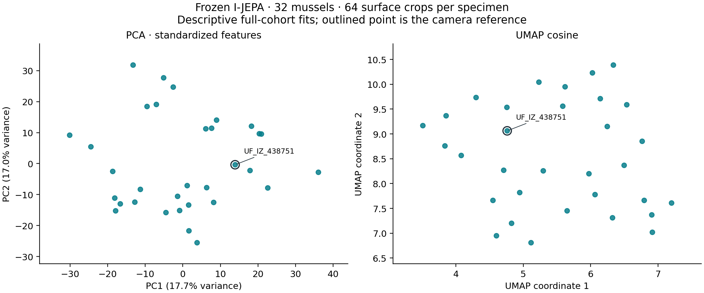

# Learned-color reproduction: October 6, 2026

**Executed successfully on the recovered 32-specimen cohort.** The documented
frozen I-JEPA method produced 2,048 crop vectors, 32 unit specimen vectors,
PCA/UMAP coordinates and 160 cosine-neighbor rows. The earlier 47-specimen run is
retained separately below. These are explicitly labeled method reruns; they do
not certify the numerical values in Eric's original experiment.

## Paper and Slack recovery

The local `Coloring paper draft.docx` already gives the checkpoint name,
group-PCA camera reference, 64 unaugmented 256² crops, token/patch averaging,
single specimen L2 normalization, standardized PCA and cosine UMAP settings.
Recovering Eric's original configuration is not a prerequisite for reconstructing
those documented steps. The draft states a 32-specimen cohort but does not list
all specimen IDs.

The [May 26 dataset handoff](https://humanaugmente-e7j6563.slack.com/archives/C09D45GJ8RX/p1779843465024659)
contains Charlie Clark's `32_clams.zip`, with 32 models, 32 textures and 32 landmark
files. Every mesh/texture checksum matches the corresponding member of the
previously available 47-specimen collection. The example configuration now lists
these 32 IDs explicitly; no subset was inferred from morphology or analysis.

Eric's [June 21 PCA image](https://humanaugmente-e7j6563.slack.com/archives/C09D45GJ8RX/p1782083178344569)
and [UMAP image](https://humanaugmente-e7j6563.slack.com/archives/C09D45GJ8RX/p1782082893348299)
were downloaded and inspected. The union of their legible specimen labels matches
all 32 IDs in the archive. These supply an original cohort and qualitative
outputs. However, Eric's [June 25 method explanation](https://humanaugmente-e7j6563.slack.com/archives/C09D45GJ8RX/p1782421921119709)
explicitly describes rendering without rotational alignment. Those earlier
proof-of-concept images are therefore not a numerical baseline for the updated
v2.2 group-PCA protocol. No original embedding arrays or coordinates were attached
to the inspected I-JEPA thread.

There is also a figure/method mismatch in the local draft. Immediately after the
32-mussel I-JEPA method, the embedded `media/image7.png` shows a standardized
I-JEPA PCA of six native fish (`Mchenga_m1`, `Nimbo_f1`, `Nimbo_f2`,
`yellowhead_m2`, `yellowhead_m4`, `yellowhead_m5`). It is not an image of the
described 32-mussel population. This rerun follows the stated mussel method and
does not certify that six-fish image or its unspecified source run.

## Recovered 32-specimen execution

The complete pipeline ran anew on the unmodified archive's paired native inputs,
using the same pinned checkpoint, environment and MPS device as the earlier run.
The standardized PCA components explain **17.7140% and 17.0422%** of variance.
UMAP and five-neighbor analysis were fitted to exactly these 32 specimens.

- All 32 exterior renders and all 2,048 patch images are byte-identical to the
  corresponding artifacts from the earlier 47-specimen run. Each specimen has
  64 distinct patches; every pixel exceeds the surface alpha threshold, every
  patch matches its source pixels and checksum, and maximum pairwise IoU is
  0.599063.
- Fresh inference produced a 2,048 × 1,280 crop matrix and a 32 × 1,280 specimen
  matrix. All values are finite. The specimen vectors exactly equal the matching
  vectors from the independent earlier run; no embedding arrays were reused.
- Independent float64 raw-crop averaging and normalization matches the specimen
  vectors within `7.90e-8`. Independent float64 cosine ranking matches all 160
  saved neighbor rows. Reapplying the saved standardized PCA transform matches
  coordinates within `1.77e-5`.
- The completion marker, input/source hashes, expected count and ordered joins
  were checked. The clean export was visually inspected.

The [32-specimen evidence](evidence/2026-10-06-slack-32/) includes the archive
and input provenance, paper/Slack recovery record, resolved protocol, numerical
checks, coordinates, neighbors, summary and clean population figure. Original
Slack screenshots, native inputs, crops and full matrices remain in ignored
local data.



```sh
MPLBACKEND=Agg data/learned-color/env/bin/python -m experiments.learned_color \
  --config data/learned-color/slack-32.json --stage all
MPLBACKEND=Agg data/learned-color/env/bin/python -m experiments.learned_color.plot \
  --run data/learned-color/runs/2026-10-06-slack-32 \
  --output data/learned-color/exports/2026-10-06-slack-32
```

`slack-32.json` is the ignored machine-specific configuration. The portable
example now carries the recovered specimen list. Complete local artifacts are
in `data/learned-color/runs/2026-10-06-slack-32/`.

## Source and method identity

- Author source: `bshi42/3d_color_package`, `learned-color-space` at
  `b30c495c701093e456231ec8a035012266ccef74`, October 3.
- Its parent is the requested `demo` head
  `464edfb77836ee192741391c5fcde0982c1ad0b0`.
- Eric's renderer, patch-selection helpers and technical description are
  attributed under `experiments/learned_color/reference/`. The pinned source
  manifest lists the two import/typing adaptations.
- The main integration independently implements the documented v2.2 group-PCA,
  alpha cropping, no-jitter sampling, frozen token pooling and specimen
  aggregation protocol. It is not the absent `ijepa_pipeline_2.py`.
- Encoder: `facebook/ijepa_vith14_1k` at immutable revision
  `f157467ea509bc356ff9f61fd3c0d840eec5e04e`, float32, eager attention, explicit MPS
  device. The Mac device choice is recorded rather than equated to Eric's GPU.

## Earlier 47-specimen execution

All 47 exact-stem OBJ/texture pairs in the supplied `Mussels` folder were used.
No 32-specimen subset was guessed. Every input mesh and texture was hashed.
The common camera-reference specimen is `UF_IZ_438751`. Each 2048² exterior
render was cropped with 12-pixel padding and square stretching, then sampled
into 64 distinct 256² all-surface patches, with maximum pairwise IoU 0.6.
Frozen 256-token means yielded 1280-dimensional raw crop vectors. Their
specimen means were normalized once.

The first two standardized PCA components explain 16.5532% and 15.2891% of
full-cohort variance. These are descriptive summaries, not taxonomic accuracy
or out-of-sample performance. UMAP used cosine distance, ten neighbors,
`min_dist=0.1`, seed 42 and one execution thread. Five non-self cosine neighbors
were recorded per specimen.

## Earlier 47-specimen checks

- All 3,008 saved patches exactly match the corresponding source-render pixels;
  no flips or photometric augmentation occurred. Every patch pixel exceeds the
  documented alpha threshold, all background fractions are zero, and every
  patch SHA256 matches its manifest. Each specimen has exactly 64 patches.
- The maximum pairwise crop IoU is 0.599063, below the 0.6 limit.
- Independently averaging the saved raw vectors in float64 and normalizing them
  matches the 47 saved vectors with maximum absolute difference `7.90e-8`.
  All crop and specimen values are finite, and specimen order joins exactly.
- Independently computed cosine-neighbor rankings match all saved rows.
- Applying the saved scaler and PCA transform independently reproduces coordinate
  values within `1.87e-5`, consistent with float32 fitted transform arithmetic.
- A same-cohort config with expected count 32 is rejected before execution.
- A modified saved patch is rejected before model loading; original artifacts
  were restored and their checksums reverified.
- Ruff checks/formatting, Python compilation, CLI help and Git whitespace checks
  passed for the integration. Per the repository's initial implementation policy,
  no permanent automated test suite was added. Focused disposable checks and
  their numerical receipts are retained beside the local run.
- An exterior render and the exported population figure were visually inspected.
  The export avoids overlapping specimen labels; exact IDs remain in the CSV.

Bounded evidence is checked in under
[`evidence/2026-10-06/`](evidence/2026-10-06/): input/source/environment provenance,
independent checks, coordinates, neighbors, summary and a figure. Native inputs,
rendered specimen images, crops, checkpoint weights and full embedding matrices
remain outside Git in `data/learned-color/`.

## Earlier 47-specimen commands and artifacts

The actual local run used the separate Python 3.12.8 environment:

```sh
data/learned-color/env/bin/python -m experiments.learned_color \
  --config data/learned-color/local-47.json --stage all
MPLBACKEND=Agg data/learned-color/env/bin/python -m experiments.learned_color.plot \
  --run data/learned-color/runs/2026-10-06-47 \
  --output data/learned-color/exports/2026-10-06-47
```

`local-47.json` is an ignored machine-specific configuration. The portable paper
example and environment instructions are in the
[experiment README](../../experiments/learned_color/README.md).
`data/learned-color/runs/2026-10-06-47/` retains complete outputs, model and
processor metadata, exact input hashes and a completion marker. A completion
marker establishes this configured run only.

## Still needed for original-output numerical comparison

1. Original embedding/coordinate arrays associated with a specified protocol
   version and figure-to-run mapping.
2. Original immutable model revision, numerical environment and device details.
   The draft names the checkpoint; this reconstruction pins a specific revision.

The original pipeline and active YAML would help diagnose numerical differences,
but the documented method and recovered cohort are sufficient to run the
reconstruction. The cohort list and June qualitative figures are now recovered.

The source document explicitly distinguishes existing v2.1 outputs from the
v2.2 protocol. The 47-specimen run remains a separate descriptive result;
recovering the June figures does not establish numerical equivalence to either
protocol version.
