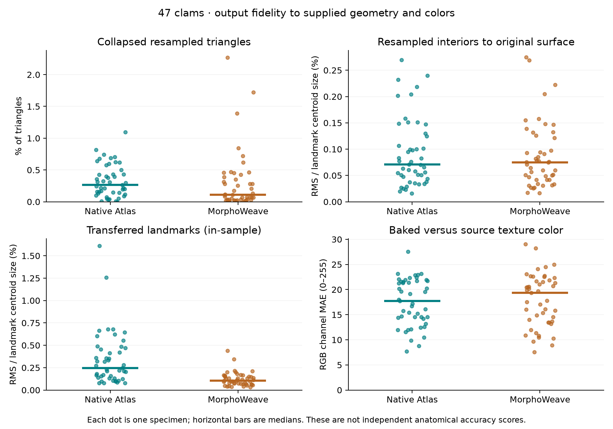

# Performance and numerical findings: 47 clams

The comparison is complete: three fresh-process timing runs, a span capture,
a CPU capture, and an allocation capture for each version/backend. All **24
captures pass**, with **253 identical numerical output fingerprints per backend**
across B0 and current code, matching checked metadata and compatible environments.
The final uv pytest run passes **24 tests**; its three warnings are existing VTK
deprecations. The final audit confirms unchanged original inputs, frozen sources,
runtime identity, production code, and upstream pin. See the
[full tables, call stacks, and charts](RESULTS.md).

This compares pre-optimization InterDeCA B0 (`31fb5d9`, retaining the `129c2e2`
numerical code) with current `3aa93df`, independently for Native Atlas and
MorphoWeave. It does not rerun the original `3d_color_package` implementation or
the Slicer UI. Both clients use the shared application core; these measurements
exercise it through the CLI in the uv environment.

Measurements ran on macOS 26.6.2 ARM64 with 24 GiB RAM and 14 logical CPUs,
Python 3.13.12, and Blender 5.2.1 LTS. Operating-system file caches were left
intact; the full report retains the three-run ranges and whole-host memory
context. These are measurements on this host, not guarantees for every machine.

## Performance

| Metric | Native Atlas: B0 → current | MorphoWeave: B0 → current |
| --- | ---: | ---: |
| Median application elapsed time | 677.840 → 623.609 s (**8.00% lower**) | 1,354.739 → 1,187.192 s (**12.37% lower**) |
| Median application CPU time | 583.386 → 532.756 s (**8.68% lower**) | 1,256.067 → 1,094.981 s (**12.82% lower**) |
| Maximum sampled application RSS | 11.103 → 8.877 GiB (**20.05% lower**) | 11.048 → 7.462 GiB (**32.45% lower**) |
| Maximum OS high-water RSS | 11.106 → 8.885 GiB | 11.059 → 7.597 GiB |
| Peak tracked allocations | 11.539 → 6.135 GiB (**46.83% lower**) | 10.708 → 6.703 GiB (**37.40% lower**) |

Timing excludes interpreter startup and Slicer rendering. CPU time excludes
Blender's separate processes. The RSS comparison uses the maximum across three
repeats, not a median; allocator retention and other host activity affect RSS.
Profiler runtimes are excluded from these performance claims.

Current MorphoWeave takes about **1.90 times** the elapsed time of current Native
Atlas for this workload. Gains are substantially smaller than the three-clam
MorphoWeave result.

The span captures show why repeated serialization remains important:

| MorphoWeave metric | B0 | Current |
| --- | ---: | ---: |
| OBJ reads | 236 | 228 |
| Logical OBJ input volume | 19.011 GiB | 18.560 GiB |
| OBJ writes | 283 | 236 |
| Logical OBJ output volume | 20.575 GiB | 16.782 GiB |
| OBJ parsing, exclusive thread CPU | 483.405 s | 471.878 s |
| OBJ writing, exclusive thread CPU | 493.332 s | 403.233 s |

In the span captures, combined exclusive OBJ parsing/writing CPU is **78.6% →
79.5%** of MorphoWeave's application session CPU, versus **41.1% → 44.6%** for
Native Atlas. These shares use the denominator from the same capture and exclude
executed Blender processes. They identify a CPU bottleneck in geometry codecs;
they do not measure physical disk waiting.

The current cache records **8 hits, 181 misses, and 219 evictions**, with a peak
of ten entries. Its array budget is 192 MiB and its measured peak is about
191.44 MiB. Closing it leaves zero entries and zero array bytes. Its limited
reuse explains why the dramatic reduction in reads on three clams does not
carry over to this larger working set. The cache budget does not limit geometry
held by the caller or upstream algorithm. Logical file bytes do not establish a
physical disk bottleneck; the codec figures measure CPU work in a separate span
capture and are not a partition of baseline CPU time.

## What occupies the memory peaks

Both B0 allocation peaks occur during texture validation for baking and include
**6 GiB of image buffers**. An 8192² RGBA image represented as float64 occupies
`8192 × 8192 × 4 × 8` bytes, or **2 GiB**. At the observed peak, that decoded
array coexists with two more RGB/alpha buffer sets from boundary and internal
validation. Retained geometry and other allocations bring the total to
11.539 GiB for Native Atlas and 10.708 GiB for MorphoWeave.

Current Native Atlas peaks at **6.135 GiB**, with geometry retained alongside
large OBJ serialization buffers. Three allocations at
`MeshIO.write_obj`'s `stream.getvalue().encode("utf-8")` call total about
**1.917 GiB** while saving a large aligned specimen. This identifies whole-file
text materialization as a concrete remaining memory cost.

Current MorphoWeave peaks at **6.703 GiB** while importing geometry for upstream
mean-atlas construction. Its three largest parser/OBJ-index allocation entries
alone account for **2.135 GiB**; two large upstream `cleanPolyData` entries add
about **0.968 GiB**. The original population geometry is also retained. The
parser entries include Python allocator arenas, which can contain unused slots;
they are not an exact count of live Python objects.

These are simultaneous tracked allocation peaks from separate Memray runs.
They exclude allocations made before tracking starts and executed Blender
processes. Allocation origins are not necessarily current object owners, and
these peaks are distinct from RSS or cumulative copy volume. Full stack records
are retained in the [B0](B0-summary.json) and [current](current-summary.json)
summaries.

The next measured targets are streaming OBJ output without whole-file text/byte
copies and reducing repeated parsing of geometry already available to the
application. Any such change should retain the same output checks and repeat
this timing/allocation comparison. This task makes no production numerical changes.

## Numerical preservation and backend differences

The optimizations preserve the output exactly **within each backend**. The
following differences are between Native Atlas and MorphoWeave, and therefore
also apply to their respective B0 outputs.

| Atlas property | Native Atlas | MorphoWeave |
| --- | ---: | ---: |
| Vertices | 112,979 | 87,082 |
| Triangles | 231,597 | 177,665 |
| Landmark centroid size | 0.130584365 | 0.131916678 |
| Mean input landmark centroid size | 0.131916678 | 0.131916678 |

MorphoWeave restores the expected representative input scale. Native Atlas's
atlas centroid size is about 1% smaller. Fitting MorphoWeave's atlas landmarks
to Native's requires scale **0.989795088**. Landmark RMS falls from **0.000336602**
after a rigid fit to **0.000274855** after fitting scale as well.

After the rigid fit, bidirectional atlas surface RMS distances are **0.000238265**
and **0.000209125** in input coordinate units. After the landmark-based scale fit,
they are **0.000281740** and **0.000250751**. The fitted scale minimizes landmark
error, not surface distance; it need not improve the latter. Restoring scale
does not make the mean shapes equivalent.

## Fidelity across all 47 specimens

The following values are medians over specimens. Percentages of centroid size
use each specimen's own aligned landmark centroid size, not its shell length.

| Metric | Native Atlas | MorphoWeave |
| --- | ---: | ---: |
| Collapsed resampled triangles | 0.264% | 0.109% |
| Resampled triangle-interior RMS / centroid size | 0.0708% | 0.0749% |
| Original-to-resampled surface RMS / centroid size | 0.3656% | 0.3813% |
| Transferred-landmark RMS / centroid size | 0.2469% | 0.1037% |
| Resampled / original surface area | 1.0825 | 1.0698 |
| Baked-versus-source RGB channel MAE, on 0–255 | 17.710 | 19.363 |
| Baked-versus-source mean Delta E 76 | 8.934 | 8.961 |
| Joint valid texture coverage | 97.76% | 98.75% |

MorphoWeave improves the median landmark-transfer residual and collapsed-face
fraction. Surface-distance and color results are mixed. Color error is conditional
on valid coverage, which differs between backends. Neither backend is established
as uniformly more accurate by these measurements.

The worst cases matter. MorphoWeave's maximum collapsed-face fraction is
**2.267%** for `UF_IZ_507900`, versus Native's maximum **1.095%** for
`UF_IZ_507399`. `UF_IZ_507900` also has the largest landmark-transfer residual in
both backends: **1.611%** of centroid size for Native and **0.438%** for MorphoWeave.
Both have their largest reverse surface-coverage RMS on this specimen, about
**1.4%** of centroid size.

Sampled resampled vertices lie extremely close to the original surfaces, but that does
not ensure triangle-interior fidelity or surface coverage. Surface-area ratios
above one can reflect bridges, folds, or overlap rather than useful additional
detail. The landmark transfer check is **in-sample**: these landmarks also guide
construction, and the residual includes atlas landmark-to-surface offsets.
It is not independent anatomical validation.

Individual specimen sizes are preserved to floating-point precision: the largest
absolute deviation of aligned/input centroid-size ratio from one is about
`6.7e-16` for Native and `1.0e-8` for MorphoWeave.

After removing each specimen's pose, median cross-backend surface RMS differences
are **0.1813%** and **0.1598%** of centroid size in the two directions. Median
cross-backend color MAE at approximately matched atlas locations is **18.546/255**;
the average textures differ by **11.957/255**. Matching uses nearest spatial
locations after a rigid atlas fit, not identical UV pixel indices, and is not a
proven anatomical correspondence map.

PCA pairwise specimen-distance correlation is **0.988412**, with **7.402% relative
RMS distance difference**. Population structure is similar under this diagnostic,
but the underlying sampled feature spaces differ; this is not a model-accuracy
score.

## Inputs and measurement scope

The `mussels_52` directory and its reviewed manifest contain **47 complete
specimens**, which the user approved using. All 141 original input hashes match
the reviewed reference manifest. Each specimen has 48 landmarks. Source textures
remain at their original resolution: 27 at 4096², 18 at 8192², and two at 2048².
The aligned originals in both backends contain **9,877,061 vertices and
19,753,936 triangles** in total. The largest, `UF_IZ_507898`, contains 1,506,788
vertices and 3,013,576 triangles. These are full source meshes before atlas
resampling; specimen count alone does not capture the workload's size.

Both workflows load all source meshes before atlas construction. One copy of
their 64-bit vertex, triangle-index, and per-corner UV arrays occupies about
1.545 GiB, before parser temporaries, Python objects, aligned/resampled geometry,
or VTK copies. This is a calculated array footprint, not a measured RSS peak.
Source texture inspection retains paths after decoding each image, not all
full-resolution decoded images. The separate MorphoWeave cache does not bound
the population geometry retained by its caller.

Both revisions reject one exactly zero-area triangle in raw `UF_IZ_63733.obj`.
For this benchmark, zero-based face **177014** was removed only from the private
common input copy. All vertices, remaining face order, and remaining per-corner
UVs were preserved. Original files were not modified. Geometry and landmarks
were converted from LPS to RAS consistently. These results therefore apply to
that identically prepared input set; the unmodified raw set fails validation.

The action chain includes dense atlas construction, alignment, correspondence,
512² texture baking, 1,000-face neighbor-averaged color sampling, two-component
PCA, swapped axes, reconstruction, display, selection, export, and clear-selection.
UMAP and Slicer UI/render timing are outside this fixed comparison workload.

Surface diagnostics use 10,000 area-weighted samples per direction, seed 413.
The separate vertex diagnostic samples up to 10,000 vertex indices per specimen.
Sampled maxima are not exact Hausdorff bounds. Color diagnostics use bilinear
sampling with premultiplied alpha and Blender pixel centers, requiring alpha
of at least 0.99 in both images. They combine projection and baking effects.
Distances retain input coordinate units; no millimeter assumption is made.

The durable capture archive is
`~/Library/Application Support/InterDeCA/full-population-2026-10-03`.
It contains the final `comparison.json`, complete `accuracy.json` with all
per-specimen measurements, the input/repair manifest, source snapshots, logs,
and all 24 complete outputs and profiling captures. An initial CPU startup was
stopped to extend the profiler timeout and is retained separately under
`diagnostics/timeout-extension`; it is excluded from the comparison matrix.
Reproduction is documented in
[the population benchmark guide](../../../tools/profiling/POPULATION.md).
