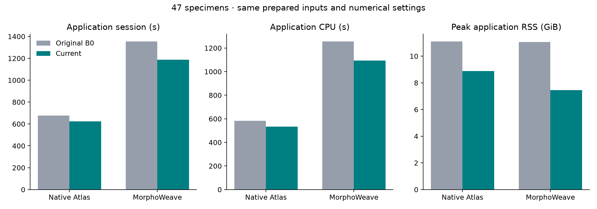

# Full-population comparison: 47 clams

This compares pre-optimization InterDeCA B0 with the current application, for both Native Atlas and MorphoWeave. It does not rerun the older `3d_color_package` implementation. The directory is named `mussels_52`, but its reviewed manifest and complete inputs contain 47 specimens.

Original capture revision: `31fb5d95fc255ae82528c26b9b4a098dea1d59f7` (the `129c2e2` numerical implementation plus its profiling harness). Current capture revision: `3aa93df76d4736d5d877f3fa4783de71610391d4`. Both use the same uv environment and pinned, unmodified MorphoWeave source.

## Input preparation

Source files were read-only and hashed. Dense meshes and landmarks were converted from LPS to RAS without decimation or image resizing. The raw `UF_IZ_63733` mesh contains one exactly zero-area triangle (zero-based face 177014; two coincident corners). Both revisions reject it under strict source validation. That one face was removed only from the private common input copy, preserving all vertices and the order and corner UVs of all remaining faces. Thus these are measurements of the identically prepared 47-specimen dataset; the unmodified raw dataset fails validation.

Source images comprise 27 at 4096², 18 at 8192², and two at 2048². Each specimen has 48 landmarks. Baking is 512² and color analysis samples 1,000 faces with neighbor averaging, followed by two-component PCA, swapped axes, reconstruction, display, selection, export, and clear-selection.

| Aligned originals | Total vertices | Total triangles | Largest specimen | Its vertices | Its triangles |
| --- | --- | --- | --- | --- | --- |
| native | 9,877,061 | 19,753,936 | `UF_IZ_507898` | 1,506,788 | 3,013,576 |
| morphoweave | 9,877,061 | 19,753,936 | `UF_IZ_507898` | 1,506,788 | 3,013,576 |

These counts describe the full aligned source meshes, before resampling to the atlas topology. Matching per-specimen source counts across backends: **True**. Specimen count alone does not describe this workload's memory and codec costs.

Both workflows inspect and retain all source meshes before atlas construction. One copy of this population's vertex, triangle-index, and per-corner UV arrays alone occupies about **1.545 GiB** under the mesh record's 64-bit representation. This calculated array footprint excludes Python objects, parser temporaries, aligned/resampled geometry, and VTK copies; it is not a measured RSS peak. Source texture inspection retains paths after decoding each image, not all full-resolution decoded images. MorphoWeave's separate 192 MiB cache does not bound caller-owned population geometry.

## Performance

| Metric | Native Atlas: B0 → current | MorphoWeave: B0 → current |
| --- | --- | --- |
| Application session (s) | 677.840 → 623.609 (8.00% reduction) | 1354.739 → 1187.192 (12.37% reduction) |
| Atlas + texture transfer (s) | 551.126 → 499.095 (9.44% reduction) | 1258.268 → 1092.735 (13.16% reduction) |
| Color processing (s) | 124.800 → 122.079 (2.18% reduction) | 94.849 → 93.124 (1.82% reduction) |
| Application CPU (s) | 583.386 → 532.756 (8.68% reduction) | 1256.067 → 1094.981 (12.82% reduction) |
| Blender CPU (s) | 84.032 → 81.985 (2.44% reduction) | 82.280 → 81.192 (1.32% reduction) |
| Peak application RSS (GiB) | 11.103 → 8.877 (20.05% reduction) | 11.048 → 7.462 (32.45% reduction) |
| Peak application + Blender RSS (GiB) | 11.103 → 8.877 (20.05% reduction) | 11.048 → 7.462 (32.45% reduction) |
| Peak tracked allocations (GiB) | 11.539 → 6.135 (46.83% reduction) | 10.708 → 6.703 (37.40% reduction) |

Timing/CPU values are medians of three fresh-process baseline captures per implementation/backend. Resident memory is the maximum sampled peak across those repeats. Separate span, CPU, and allocation captures are excluded from timing claims, giving 24 captures total. Session wall time and application CPU exclude interpreter startup and Slicer rendering. CPU is processor time, not elapsed time. Output fingerprinting, storage compaction, accuracy diagnostics, and report generation happen outside the measured child. RSS includes allocator retention; simultaneous process-tree RSS can double-count shared pages. Memray excludes executed Blender processes.

| Version | Backend | Repeats | Session range (s) | RSS peak range (GiB) | OS high-water RSS range (GiB) |
| --- | --- | --- | --- | --- | --- |
| B0 | Native Atlas | 3 | 672.308–735.187 | 8.662–11.103 | 8.662–11.106 |
| B0 | MorphoWeave | 3 | 1332.098–1395.648 | 8.944–11.048 | 8.952–11.059 |
| current | Native Atlas | 3 | 620.028–624.644 | 6.057–8.877 | 6.214–8.885 |
| current | MorphoWeave | 3 | 1179.298–1191.442 | 6.348–7.462 | 6.355–7.597 |

### Whole-host memory context

| Version | Capture | Monitor coverage | Minimum available RAM (GiB) | psutil sin delta (GiB) | psutil sout delta (GiB) |
| --- | --- | --- | --- | --- | --- |
| B0 | morphoweave-baseline-1 | complete | 3.97 | 26.34 | 0.06 |
| B0 | morphoweave-baseline-2 | complete | 4.19 | 23.97 | 0.05 |
| B0 | morphoweave-baseline-3 | complete | 3.91 | 22.11 | 0.03 |
| B0 | native-baseline-1 | partial | 9.42 | 0.31 | 0.00 |
| B0 | native-baseline-2 | complete | 4.16 | 7.07 | 0.02 |
| B0 | native-baseline-3 | complete | 4.15 | 6.81 | 0.03 |
| current | morphoweave-baseline-1 | complete | 5.35 | 21.84 | 0.04 |
| current | morphoweave-baseline-2 | complete | 5.16 | 30.75 | 0.07 |
| current | morphoweave-baseline-3 | complete | 6.13 | 21.74 | 0.04 |
| current | native-baseline-1 | complete | 6.60 | 6.62 | 0.02 |
| current | native-baseline-2 | complete | 4.97 | 7.42 | 0.03 |
| current | native-baseline-3 | complete | 7.77 | 6.20 | 0.01 |

These two-second samples describe the whole computer, including other applications. Existing swap usage is not a measure of this application's allocations. On this macOS host, psutil 7.2.2's sin/sout fields are broader page-in/page-out counters, not dedicated swap-in/swap-out counters; see its [platform implementation](https://github.com/giampaolo/psutil/blob/release-7.2.2/psutil/arch/osx/mem.c#L100-L101). Their deltas cover only the observed interval, cannot be attributed entirely to InterDeCA, and do not by themselves establish swap thrashing. The first run has partial monitoring; captures were fresh processes, with operating-system file caches left intact.

### Where the elapsed time goes

MorphoWeave preparation + atlas + alignment takes a median **800.07 → 702.78 s** across each version's three normal runs. This groups the stages whose boundaries changed during optimization.

| Task family | Native Atlas: B0 → current (s) | MorphoWeave: B0 → current (s) |
| --- | --- | --- |
| `atlas` | 0.34 → 0.35 | 403.60 → 306.18 |
| `morphoweave_aligned` | 0.00 → 0.00 | 396.47 → 298.52 |
| `bake` | 144.79 → 106.44 | 144.23 → 105.00 |
| `inspect` | 134.91 → 115.17 | 141.36 → 114.56 |
| `aligned` | 95.38 → 97.52 | 94.52 → 95.01 |
| `morphoweave_inputs` | 0.00 → 0.00 | 0.00 → 96.31 |
| `sample` | 91.58 → 90.45 | 71.29 → 69.93 |
| `contribute` | 76.37 → 75.86 | 0.00 → 0.00 |
| `resampled` | 51.72 → 53.07 | 40.32 → 39.13 |
| `resample` | 42.88 → 42.74 | 29.80 → 29.48 |
| `analysis` | 27.38 → 27.10 | 19.94 → 19.57 |

Each entry is the median sum of that task family's durations over a complete run. Families taking at least five seconds in any implementation are shown; zero means the family is absent or negligible. Native atlas construction includes the per-specimen `contribute` tasks and the final `atlas` task. `inspect` validates source inputs, `aligned` and `resampled` write output files, and `resample` constructs correspondence. `bake` includes waiting for Blender; `analysis` prepares color analysis and `sample` evaluates specimen colors. B0 stages MorphoWeave inputs inside its high-level atlas/alignment tasks; current code exposes shared staging as `morphoweave_inputs`, so those three families must be considered together. Task medians need not sum to the median application session, which also includes work outside tasks.

### Retention and serialization

| Metric | Native Atlas: B0 → current | MorphoWeave: B0 → current |
| --- | --- | --- |
| Manager-retained arrays (GiB) | 4.765 → 3.109 | 3.808 → 3.112 |
| OBJ reads (calls) | 47.000 → 47.000 | 236.000 → 228.000 |
| OBJ input volume (GiB) | 3.794 → 3.794 | 19.011 → 18.560 |
| OBJ writes (calls) | 95.000 → 95.000 | 283.000 → 236.000 |
| OBJ output volume (GiB) | 5.898 → 5.898 | 20.575 → 16.782 |
| Instrumented array copies (GiB) | 221.471 → 19.526 | 247.720 → 50.168 |

Manager retention is the maximum unique NumPy-buffer ownership reported at task boundaries in baseline captures; it excludes objects held elsewhere. Codec calls, logical file volume, and cumulative instrumented array-copy volume come from the separate span capture. Logical bytes are not physical disk traffic, and cumulative copy bytes are not peak live memory. The bounded cache does not limit total population geometry held by the algorithms.

| Version | Backend | OBJ parsing CPU (s) | OBJ writing CPU (s) | Combined codec CPU (s) | Same-capture session CPU (s) | Codec share (%) |
| --- | --- | --- | --- | --- | --- | --- |
| B0 | native | 97.32 | 143.72 | 241.04 | 586.00 | 41.1 |
| B0 | morphoweave | 483.41 | 493.33 | 976.74 | 1243.17 | 78.6 |
| current | native | 96.10 | 141.95 | 238.05 | 533.35 | 44.6 |
| current | morphoweave | 471.88 | 403.23 | 875.11 | 1100.64 | 79.5 |

These are exclusive thread-CPU measurements from the separate span pass. The share divides their sum by application process CPU from that same session; executed Blender processes are excluded from both. They expose serialization/parsing work, not elapsed disk waiting, and are not a partition of baseline CPU time.

| Current MorphoWeave span capture | Value |
| --- | --- |
| Array budget / observed peak (MiB) | 192.00 / 191.44 |
| Hits / misses / evictions | 8 / 181 / 219 |
| Peak entries | 10 |
| Entries / array bytes after close | 0 / 0 |

The bounded cache is much smaller than this working set. Its limited reuse explains why the small-clams reduction in repeated OBJ reads does not carry over to 47 specimens. Closing this cache does not release geometry still owned by the caller or upstream algorithm.

### Function-level CPU attribution

Yappi records Python-thread CPU, including built-in calls, in a separate capture. The ten largest self-time entries below combine that capture's sequential application pipelines. Profiling is enabled during execution-manager pipelines; work between those pipelines is outside these call tables. Self time excludes called functions; inclusive time includes them and must not be summed across rows. Deterministic profiling substantially slows Python-heavy codecs, so these instrumented values identify call sites but do not estimate normal runtime. Executed Blender processes are excluded.

**B0 / native**

Profiled session: 3957.35 s; normal baseline median: 677.84 s. This instrumented capture took 5.84 times as long; the ratio also includes host and run-to-run variation.

| Function | Source | Calls | Self CPU (s) | Inclusive CPU (s) |
| --- | --- | --- | --- | --- |
| `_read_obj` | `B0/src/interdeca/io.py:129` | 47 | 665.22 | 1251.90 |
| `<method 'join' of 'str' objects>` | `builtins:0` | 138,785,497 | 312.61 | 900.45 |
| `<genexpr>` | `B0/src/interdeca/io.py:243` | 277,835,328 | 307.96 | 475.38 |
| `write_obj` | `B0/src/interdeca/io.py:209` | 95 | 236.76 | 1232.59 |
| `format` | `builtins:0` | 231,123,711 | 209.77 | 209.77 |
| `visit` | `B0/tools/profiling/capture.py:61` | 488 | 180.49 | 304.66 |
| `len` | `builtins:0` | 288,219,802 | 174.24 | 174.24 |
| `<method 'append' of 'list' objects>` | `builtins:0` | 228,568,952 | 140.96 | 140.96 |
| `<method 'FindClosestPoint' of 'vtkmodules.vtkCommonDataModel.vtkStaticCellLocator' objects>` | `builtins:0` | 15,132,167 | 108.01 | 108.01 |
| `average` | `.venv/lib/python3.13/site-packages/numpy/lib/_function_base_impl.py:450` | 10,569,717 | 103.65 | 680.43 |

**B0 / morphoweave**

Profiled session: 11979.50 s; normal baseline median: 1354.74 s. This instrumented capture took 8.84 times as long; the ratio also includes host and run-to-run variation.

| Function | Source | Calls | Self CPU (s) | Inclusive CPU (s) |
| --- | --- | --- | --- | --- |
| `_read_obj` | `B0/src/interdeca/io.py:129` | 236 | 3459.21 | 6441.29 |
| `<method 'join' of 'str' objects>` | `builtins:0` | 482,763,130 | 1088.08 | 3132.34 |
| `<genexpr>` | `B0/src/interdeca/io.py:243` | 965,678,400 | 1071.41 | 1652.66 |
| `write_obj` | `B0/src/interdeca/io.py:209` | 283 | 839.31 | 4304.10 |
| `len` | `builtins:0` | 1,353,343,408 | 816.47 | 816.47 |
| `format` | `builtins:0` | 804,481,323 | 728.63 | 728.63 |
| `<method 'append' of 'list' objects>` | `builtins:0` | 1,139,654,304 | 714.21 | 714.21 |
| `<method 'split' of 'str' objects>` | `builtins:0` | 742,489,790 | 505.81 | 505.81 |
| `_obj_index` | `B0/src/interdeca/io.py:198` | 593,982,864 | 414.21 | 414.21 |
| `<method 'write' of '_io.StringIO' objects>` | `builtins:0` | 482,755,924 | 314.79 | 314.79 |

**current / native**

Profiled session: 3901.04 s; normal baseline median: 623.61 s. This instrumented capture took 6.26 times as long; the ratio also includes host and run-to-run variation.

| Function | Source | Calls | Self CPU (s) | Inclusive CPU (s) |
| --- | --- | --- | --- | --- |
| `_read_obj` | `current/src/interdeca/io.py:129` | 47 | 669.68 | 1259.15 |
| `<method 'join' of 'str' objects>` | `builtins:0` | 138,785,497 | 313.00 | 897.95 |
| `<genexpr>` | `current/src/interdeca/io.py:243` | 277,835,328 | 306.42 | 472.92 |
| `write_obj` | `current/src/interdeca/io.py:209` | 95 | 235.38 | 1228.33 |
| `format` | `builtins:0` | 231,123,711 | 208.68 | 208.68 |
| `visit` | `current/tools/profiling/capture.py:62` | 488 | 179.72 | 302.54 |
| `len` | `builtins:0` | 288,218,331 | 175.29 | 175.29 |
| `<method 'append' of 'list' objects>` | `builtins:0` | 228,363,888 | 141.09 | 141.09 |
| `<method 'FindClosestPoint' of 'vtkmodules.vtkCommonDataModel.vtkStaticCellLocator' objects>` | `builtins:0` | 15,132,167 | 108.13 | 108.13 |
| `average` | `.venv/lib/python3.13/site-packages/numpy/lib/_function_base_impl.py:450` | 10,569,717 | 103.56 | 678.85 |

**current / morphoweave**

Profiled session: 10892.27 s; normal baseline median: 1187.19 s. This instrumented capture took 9.17 times as long; the ratio also includes host and run-to-run variation.

| Function | Source | Calls | Self CPU (s) | Inclusive CPU (s) |
| --- | --- | --- | --- | --- |
| `_read_obj` | `current/src/interdeca/io.py:129` | 228 | 3351.56 | 6217.59 |
| `<method 'join' of 'str' objects>` | `builtins:0` | 393,872,155 | 883.49 | 2530.87 |
| `<genexpr>` | `current/src/interdeca/io.py:243` | 787,892,976 | 862.64 | 1330.78 |
| `len` | `builtins:0` | 1,321,081,704 | 785.70 | 785.70 |
| `write_obj` | `current/src/interdeca/io.py:209` | 236 | 687.00 | 3485.01 |
| `<method 'append' of 'list' objects>` | `builtins:0` | 1,111,969,311 | 684.24 | 684.24 |
| `format` | `builtins:0` | 656,326,524 | 587.14 | 587.14 |
| `<method 'split' of 'str' objects>` | `builtins:0` | 724,568,463 | 485.71 | 485.71 |
| `_obj_index` | `current/src/interdeca/io.py:198` | 579,644,376 | 400.50 | 400.50 |
| `<method 'partition' of 'str' objects>` | `builtins:0` | 434,734,008 | 270.59 | 270.59 |

### What occupies the peak live heap

Each table shows the eight largest allocation stacks simultaneously live at that capture's Memray high-water mark. These are allocation origins, not necessarily the objects' current owners. The total uses every stack, while the table shows only the largest. Excerpts omit recorder-wrapper frames; the accompanying summaries retain complete stacks. Native allocations are tracked, but executed Blender processes and memory outside the tracked allocator are excluded. Tracking covers the CLI session, excluding earlier interpreter/import allocations. The recorder does not enable individual Python-allocator tracing: Python arenas may contain free slots, so allocation counts and sizes are not an exact census of live Python objects. Tracked allocation peaks are distinct from cumulative allocation/copy traffic and process RSS.

**B0 / native: 11.539 GiB tracked live peak**

| Live MiB | Tracked allocations | Allocation origin |
| --- | --- | --- |
| 2048.00 | 1 | `read (B0/src/interdeca/io.py:402)` ← `bake_specimen_texture (B0/src/interdeca/blender.py:282)` ← `invoke (B0/src/interdeca/workflows.py:72)` ← `_execute (B0/src/interdeca/serial_execution.py:138)` ← `_work (B0/src/interdeca/serial_execution.py:98)` |
| 2048.00 | 2 | `frozen (B0/src/interdeca/models.py:50)` ← `floating (B0/src/interdeca/serde.py:78)` ← `__init__ (.venv/lib/python3.13/site-packages/pydantic/main.py:263)` ← `read (B0/src/interdeca/io.py:403)` ← `bake_specimen_texture (B0/src/interdeca/blender.py:282)` |
| 1536.00 | 1 | `frozen (B0/src/interdeca/models.py:50)` ← `validated (B0/src/interdeca/models.py:719)` ← `validate_record (B0/src/interdeca/serde.py:181)` ← `__init__ (.venv/lib/python3.13/site-packages/pydantic/main.py:263)` ← `read (B0/src/interdeca/io.py:403)` |
| 904.26 | 47 | `frozen (B0/src/interdeca/models.py:50)` ← `validated (B0/src/interdeca/models.py:121)` ← `align_specimen (B0/src/interdeca/atlas.py:225)` ← `invoke (B0/src/interdeca/workflows.py:72)` ← `_execute (B0/src/interdeca/serial_execution.py:138)` |
| 904.26 | 47 | `frozen (B0/src/interdeca/models.py:50)` ← `validated (B0/src/interdeca/models.py:121)` ← `validate_record (B0/src/interdeca/serde.py:323)` ← `__init__ (.venv/lib/python3.13/site-packages/pydantic/main.py:263)` ← `_read_obj (B0/src/interdeca/io.py:192)` |
| 512.00 | 1 | `frozen (B0/src/interdeca/models.py:50)` ← `validated (B0/src/interdeca/models.py:719)` ← `validate_record (B0/src/interdeca/serde.py:181)` ← `__init__ (.venv/lib/python3.13/site-packages/pydantic/main.py:263)` ← `read (B0/src/interdeca/io.py:403)` |
| 498.28 | 47 | `frozen (B0/src/interdeca/models.py:50)` ← `validated (B0/src/interdeca/models.py:121)` ← `resample_specimen (B0/src/interdeca/geometry.py:382)` ← `invoke (B0/src/interdeca/workflows.py:72)` ← `_execute (B0/src/interdeca/serial_execution.py:138)` |
| 452.13 | 47 | `frozen (B0/src/interdeca/models.py:50)` ← `validated (B0/src/interdeca/models.py:94)` ← `align_specimen (B0/src/interdeca/atlas.py:225)` ← `invoke (B0/src/interdeca/workflows.py:72)` ← `_execute (B0/src/interdeca/serial_execution.py:138)` |

**B0 / morphoweave: 10.708 GiB tracked live peak**

| Live MiB | Tracked allocations | Allocation origin |
| --- | --- | --- |
| 2048.00 | 2 | `frozen (B0/src/interdeca/models.py:50)` ← `floating (B0/src/interdeca/serde.py:78)` ← `__init__ (.venv/lib/python3.13/site-packages/pydantic/main.py:263)` ← `read (B0/src/interdeca/io.py:403)` ← `bake_specimen_texture (B0/src/interdeca/blender.py:282)` |
| 2048.00 | 1 | `read (B0/src/interdeca/io.py:402)` ← `bake_specimen_texture (B0/src/interdeca/blender.py:282)` ← `invoke (B0/src/interdeca/workflows.py:72)` ← `_execute (B0/src/interdeca/serial_execution.py:138)` ← `_work (B0/src/interdeca/serial_execution.py:98)` |
| 1536.00 | 1 | `frozen (B0/src/interdeca/models.py:50)` ← `validated (B0/src/interdeca/models.py:719)` ← `validate_record (B0/src/interdeca/serde.py:181)` ← `__init__ (.venv/lib/python3.13/site-packages/pydantic/main.py:263)` ← `read (B0/src/interdeca/io.py:403)` |
| 904.26 | 47 | `frozen (B0/src/interdeca/models.py:50)` ← `validated (B0/src/interdeca/models.py:121)` ← `validate_record (B0/src/interdeca/serde.py:323)` ← `__init__ (.venv/lib/python3.13/site-packages/pydantic/main.py:263)` ← `_read_obj (B0/src/interdeca/io.py:192)` |
| 904.26 | 47 | `frozen (B0/src/interdeca/models.py:50)` ← `validated (B0/src/interdeca/models.py:121)` ← `validate_record (B0/src/interdeca/serde.py:323)` ← `__init__ (.venv/lib/python3.13/site-packages/pydantic/main.py:263)` ← `_read_obj (B0/src/interdeca/io.py:192)` |
| 512.00 | 1 | `frozen (B0/src/interdeca/models.py:50)` ← `validated (B0/src/interdeca/models.py:719)` ← `validate_record (B0/src/interdeca/serde.py:181)` ← `__init__ (.venv/lib/python3.13/site-packages/pydantic/main.py:263)` ← `read (B0/src/interdeca/io.py:403)` |
| 452.13 | 47 | `frozen (B0/src/interdeca/models.py:50)` ← `validated (B0/src/interdeca/models.py:94)` ← `validate_record (B0/src/interdeca/serde.py:323)` ← `__init__ (.venv/lib/python3.13/site-packages/pydantic/main.py:263)` ← `_read_obj (B0/src/interdeca/io.py:192)` |
| 452.13 | 47 | `frozen (B0/src/interdeca/models.py:50)` ← `validated (B0/src/interdeca/models.py:94)` ← `validate_record (B0/src/interdeca/serde.py:323)` ← `__init__ (.venv/lib/python3.13/site-packages/pydantic/main.py:263)` ← `_read_obj (B0/src/interdeca/io.py:192)` |

**current / native: 6.135 GiB tracked live peak**

| Live MiB | Tracked allocations | Allocation origin |
| --- | --- | --- |
| 904.26 | 47 | `frozen (current/src/interdeca/models.py:50)` ← `validated (current/src/interdeca/models.py:121)` ← `validate_record (current/src/interdeca/serde.py:354)` ← `__init__ (.venv/lib/python3.13/site-packages/pydantic/main.py:263)` ← `_read_obj (current/src/interdeca/io.py:192)` |
| 904.26 | 47 | `frozen (current/src/interdeca/models.py:50)` ← `validated (current/src/interdeca/models.py:121)` ← `align_specimen (current/src/interdeca/atlas.py:225)` ← `invoke (current/src/interdeca/workflows.py:72)` ← `_execute (current/src/interdeca/serial_execution.py:181)` |
| 754.97 | 1 | `write_obj (current/src/interdeca/io.py:255)` ← `save_specimen (current/src/interdeca/workflows.py:142)` ← `invoke (current/src/interdeca/workflows.py:72)` ← `_execute (current/src/interdeca/serial_execution.py:181)` ← `_work (current/src/interdeca/serial_execution.py:103)` |
| 603.98 | 1 | `write_obj (current/src/interdeca/io.py:255)` ← `save_specimen (current/src/interdeca/workflows.py:142)` ← `invoke (current/src/interdeca/workflows.py:72)` ← `_execute (current/src/interdeca/serial_execution.py:181)` ← `_work (current/src/interdeca/serial_execution.py:103)` |
| 603.98 | 1 | `write_obj (current/src/interdeca/io.py:255)` ← `save_specimen (current/src/interdeca/workflows.py:142)` ← `invoke (current/src/interdeca/workflows.py:72)` ← `_execute (current/src/interdeca/serial_execution.py:181)` ← `_work (current/src/interdeca/serial_execution.py:103)` |
| 452.13 | 47 | `frozen (current/src/interdeca/models.py:50)` ← `validated (current/src/interdeca/models.py:94)` ← `validate_record (current/src/interdeca/serde.py:354)` ← `__init__ (.venv/lib/python3.13/site-packages/pydantic/main.py:263)` ← `_read_obj (current/src/interdeca/io.py:192)` |
| 452.13 | 47 | `frozen (current/src/interdeca/models.py:50)` ← `validated (current/src/interdeca/models.py:94)` ← `align_specimen (current/src/interdeca/atlas.py:225)` ← `invoke (current/src/interdeca/workflows.py:72)` ← `_execute (current/src/interdeca/serial_execution.py:181)` |
| 449.62 | 47 | `frozen (current/src/interdeca/models.py:50)` ← `validated (current/src/interdeca/models.py:94)` ← `resample_specimen (current/src/interdeca/geometry.py:382)` ← `prepare_contribution (current/src/interdeca/atlas.py:158)` ← `invoke (current/src/interdeca/workflows.py:72)` |

**current / morphoweave: 6.703 GiB tracked live peak**

| Live MiB | Tracked allocations | Allocation origin |
| --- | --- | --- |
| 978.00 | 978 | `_read_obj (current/src/interdeca/io.py:140)` ← `read (current/src/interdeca/io.py:89)` ← `read (current/src/interdeca/_mesh_cache.py:209)` ← `loadModel (current/src/interdeca/_morphoweave_host.py:99)` ← `_load_clean_model_polydata (current/src/interdeca/_vendor/morphoweave/MorphoWeaveAtlasBuilder/MorphoWeaveAtlasBuilder.py:620)` |
| 904.26 | 47 | `frozen (current/src/interdeca/models.py:50)` ← `validated (current/src/interdeca/models.py:121)` ← `validate_record (current/src/interdeca/serde.py:354)` ← `__init__ (.venv/lib/python3.13/site-packages/pydantic/main.py:263)` ← `_read_obj (current/src/interdeca/io.py:192)` |
| 824.00 | 824 | `_read_obj (current/src/interdeca/io.py:151)` ← `read (current/src/interdeca/io.py:89)` ← `read (current/src/interdeca/_mesh_cache.py:209)` ← `loadModel (current/src/interdeca/_morphoweave_host.py:99)` ← `_load_clean_model_polydata (current/src/interdeca/_vendor/morphoweave/MorphoWeaveAtlasBuilder/MorphoWeaveAtlasBuilder.py:620)` |
| 661.11 | 39 | `cleanPolyData (current/src/interdeca/_vendor/morphoweave/MorphoWeaveAtlasBuilder/MorphoWeaveAtlasBuilder.py:701)` ← `_load_clean_model_polydata (current/src/interdeca/_vendor/morphoweave/MorphoWeaveAtlasBuilder/MorphoWeaveAtlasBuilder.py:622)` ← `importPaired (current/src/interdeca/_vendor/morphoweave/MorphoWeaveAtlasBuilder/MorphoWeaveAtlasBuilder.py:632)` ← `runMean (current/src/interdeca/_vendor/morphoweave/MorphoWeaveAtlasBuilder/MorphoWeaveAtlasBuilder.py:898)` ← `_generateAtlas (current/src/interdeca/_vendor/morphoweave/MorphoWeaveAtlasBuilder/MorphoWeaveAtlasBuilder.py:521)` |
| 452.13 | 47 | `frozen (current/src/interdeca/models.py:50)` ← `validated (current/src/interdeca/models.py:94)` ← `validate_record (current/src/interdeca/serde.py:354)` ← `__init__ (.venv/lib/python3.13/site-packages/pydantic/main.py:263)` ← `_read_obj (current/src/interdeca/io.py:192)` |
| 384.00 | 384 | `_obj_index (current/src/interdeca/io.py:204)` ← `_read_obj (current/src/interdeca/io.py:172)` ← `read (current/src/interdeca/io.py:89)` ← `read (current/src/interdeca/_mesh_cache.py:209)` ← `loadModel (current/src/interdeca/_morphoweave_host.py:99)` |
| 330.56 | 39 | `cleanPolyData (current/src/interdeca/_vendor/morphoweave/MorphoWeaveAtlasBuilder/MorphoWeaveAtlasBuilder.py:701)` ← `_load_clean_model_polydata (current/src/interdeca/_vendor/morphoweave/MorphoWeaveAtlasBuilder/MorphoWeaveAtlasBuilder.py:622)` ← `importPaired (current/src/interdeca/_vendor/morphoweave/MorphoWeaveAtlasBuilder/MorphoWeaveAtlasBuilder.py:632)` ← `runMean (current/src/interdeca/_vendor/morphoweave/MorphoWeaveAtlasBuilder/MorphoWeaveAtlasBuilder.py:898)` ← `_generateAtlas (current/src/interdeca/_vendor/morphoweave/MorphoWeaveAtlasBuilder/MorphoWeaveAtlasBuilder.py:521)` |
| 226.07 | 47 | `frozen (current/src/interdeca/models.py:50)` ← `matrix (current/src/interdeca/models.py:62)` ← `validated (current/src/interdeca/models.py:93)` ← `validate_record (current/src/interdeca/serde.py:354)` ← `__init__ (.venv/lib/python3.13/site-packages/pydantic/main.py:263)` |

[B0 memory timeline](B0-memory.png) and [current memory timeline](current-memory.png) show each backend's first baseline repeat. The peak-RSS table above uses all three repeats. Full task/function and allocation-stack summaries are in [B0-summary.json](B0-summary.json) and [current-summary.json](current-summary.json).

## Preservation of numerical output

Compatible environment: **True**. Identical numerical outputs and checked metadata across versions and repeated/instrumented runs: **True**. These checks preserve vertex order, triangle order, corner UVs, decoded texture results, population and presentation artifacts, and completed actions. They establish agreement within each backend, not equivalence between Atlas and MorphoWeave.

## Geometry and landmark measurements

| Backend | Atlas vertices | Atlas triangles | Atlas centroid size | Mean input centroid size | Atlas landmark-to-surface RMS |
| --- | --- | --- | --- | --- | --- |
| Native Atlas | 112979 | 231597 | 0.130584 | 0.131917 | 9.50156e-05 |
| MorphoWeave | 87082 | 177665 | 0.131917 | 0.131917 | 4.04232e-05 |

MorphoWeave-to-Native fitted atlas scale is **0.989795088**. Atlas landmark RMS after rigid alignment is **0.000336602**; after separately fitting scale it is **0.000274855**. Distances use input coordinate units; no millimeter assumption is made.

| Atlas alignment | Direction | RMS | P95 | Sampled maximum |
| --- | --- | --- | --- | --- |
| Rigid | Native → MorphoWeave | 0.000238265 | 0.000499451 | 0.00115679 |
| Rigid | MorphoWeave → Native | 0.000209125 | 0.00042148 | 0.00107624 |
| Similarity (fitted scale) | Native → MorphoWeave | 0.00028174 | 0.000577314 | 0.00126865 |
| Similarity (fitted scale) | MorphoWeave → Native | 0.000250751 | 0.000497666 | 0.00118897 |

Each surface direction uses 10,000 uniformly area-weighted samples (seed 413). These sampled maxima are not exact Hausdorff bounds. Proper rotations exclude reflections.

The fitted scale minimizes labeled-landmark residuals. It does not minimize surface distances, so surface RMS need not decrease after fitting it.

| Backend | Per-specimen metric | Median over 47 | Range over 47 |
| --- | --- | --- | --- |
| Native Atlas | Collapsed resampled faces (%) | 0.26382 | 0–1.09501 |
| Native Atlas | Vertex-to-original RMS | 5.37734e-19 | 2.88691e-19–1.69276e-18 |
| Native Atlas | Triangle-interior-to-original RMS | 8.63306e-05 | 2.07512e-05–0.000543362 |
| Native Atlas | Original-to-resampled RMS | 0.000435957 | 0.000127422–0.00284691 |
| Native Atlas | Triangle-interior RMS / centroid size (%) | 0.0708101 | 0.0159338–0.269805 |
| Native Atlas | Original-to-resampled RMS / centroid size (%) | 0.365572 | 0.0961772–1.41362 |
| Native Atlas | Transferred landmark RMS / centroid size (%) | 0.246864 | 0.0766556–1.61103 |
| Native Atlas | Aligned / input centroid size | 1 | 1–1 |
| Native Atlas | Resampled / original surface area | 1.08249 | 0.984603–1.23659 |
| MorphoWeave | Collapsed resampled faces (%) | 0.108631 | 0.00112571–2.26663 |
| MorphoWeave | Vertex-to-original RMS | 1.66758e-10 | 9.30163e-11–5.48695e-10 |
| MorphoWeave | Triangle-interior-to-original RMS | 9.26182e-05 | 1.82662e-05–0.000541644 |
| MorphoWeave | Original-to-resampled RMS | 0.000446349 | 0.000102519–0.00281333 |
| MorphoWeave | Triangle-interior RMS / centroid size (%) | 0.074948 | 0.0165197–0.274689 |
| MorphoWeave | Original-to-resampled RMS / centroid size (%) | 0.381313 | 0.103308–1.39695 |
| MorphoWeave | Transferred landmark RMS / centroid size (%) | 0.103687 | 0.0317622–0.438239 |
| MorphoWeave | Aligned / input centroid size | 1 | 1–1 |
| MorphoWeave | Resampled / original surface area | 1.06976 | 0.947841–1.25375 |

Projection fidelity is measured against each backend's own aligned original mesh. The vertex diagnostic samples up to 10,000 vertex indices per specimen. Vertex fidelity alone does not establish triangle-interior fidelity, surface coverage, or anatomical correspondence. Landmark transfer projects atlas landmarks to atlas triangles and carries their barycentric coordinates to the specimen. Because the landmarks also guide fitting, this is an in-sample check and includes atlas landmark-to-surface offset; it is not an independent anatomical accuracy score.

| Per-specimen cross-backend difference | Median / centroid size (%) | Range / centroid size (%) |
| --- | --- | --- |
| Aligned-landmark rigid-fit RMS | 3.63639e-07 | 2.9897e-07–4.2047e-07 |
| Resampled Native → MorphoWeave surface RMS | 0.181273 | 0.0572101–0.465778 |
| Resampled MorphoWeave → Native surface RMS | 0.159827 | 0.0433722–0.612394 |

These specimen comparisons remove pose using each specimen's labeled landmarks, without fitting its scale. Surface-area ratios above one can reflect bridging, folds, or overlapping triangles; they do not establish useful additional detail.

## Surface-color measurements

| Baked versus original source | Metric | Median over specimens | Range |
| --- | --- | --- | --- |
| Native Atlas | RGB channel MAE (0–255) | 17.7104 | 7.66779–27.539 |
| Native Atlas | RGB channel RMS (0–255) | 32.2323 | 13.2141–43.8215 |
| Native Atlas | Mean Delta E 76 | 8.93359 | 4.04607–12.4282 |
| Native Atlas | Baked valid coverage (%) | 97.76 | 96.88–98.23 |
| Native Atlas | Source valid coverage (%) | 100 | 100–100 |
| Native Atlas | Joint valid coverage (%) | 97.76 | 96.88–98.23 |
| MorphoWeave | RGB channel MAE (0–255) | 19.3633 | 7.5658–29.0366 |
| MorphoWeave | RGB channel RMS (0–255) | 33.648 | 13.5347–47.395 |
| MorphoWeave | Mean Delta E 76 | 8.96118 | 3.97576–12.1414 |
| MorphoWeave | Baked valid coverage (%) | 98.75 | 98.33–99.12 |
| MorphoWeave | Source valid coverage (%) | 100 | 100–100 |
| MorphoWeave | Joint valid coverage (%) | 98.75 | 98.33–99.12 |

Source comparison samples resampled triangle interiors, finds their nearest point on the aligned original surface, and interpolates each texture at that surface location. This combines projection and baking error. Bilinear sampling uses premultiplied alpha and Blender pixel centers. Samples require alpha ≥ 0.99 in both images; missing coverage is counted separately. Source resolution is unchanged, but baked textures are deliberately 512².

Across backends, the median specimen RGB channel MAE at common atlas surface locations is **18.546/255**. The average atlas texture has MAE **11.9565/255**. Matching uses nearest spatial points after a shared rigid atlas fit; different UV layouts are never compared at identical pixel indices. These differences do not establish which backend has better anatomical color correspondence.

PCA pairwise specimen-distance correlation is **0.988412**; relative RMS distance difference is **7.402%**. Different atlas sampling creates different feature spaces, so this is a descriptive population difference, not model accuracy.

## Evidence

Full inputs, sources, logs, numerical outputs, resource samples, CPU profiles, and allocation captures: `/Users/eric/Library/Application Support/InterDeCA/full-population-2026-10-03`. Compact [performance comparison](comparison.json), [all per-specimen accuracy measurements](accuracy.json), [input/repair manifest](dataset.json), [B0 environment](B0-environment.json), and [current environment](current-environment.json) accompany this report. The tests run in the uv environment; nothing is registered with Slicer/CMake.

[Interpretation of the performance and numerical findings](BASELINE_RESULTS.md).

Final verification evidence: [pytest output](final-pytest.log) and [source/input/runtime integrity audit](final-integrity-audit.log).
