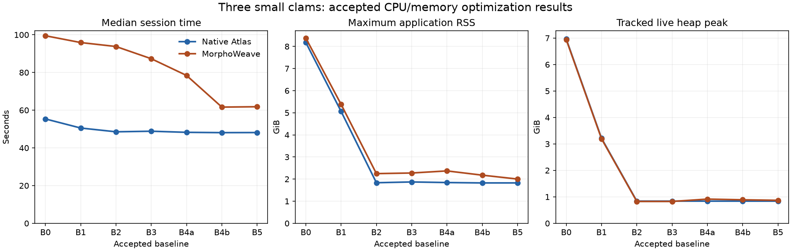

# CPU and memory optimization results

The ordered plan is complete through Phase 6. **B5 is the final accepted
application baseline**, implemented in `eac68e0` and accepted in `385815c`.
Every optimization was compared with its immediate predecessor and the preserved
B0 reference. Both backends retain their own numerical baseline; these results do
not establish scientific equivalence between Atlas and MorphoWeave.

| Final change from B0 to B5 | Native Atlas | MorphoWeave |
| --- | ---: | ---: |
| Median application session | 55.359 → 48.136 s; 13.05% lower | 99.479 → 61.829 s; 37.85% lower |
| Median application CPU | 45.932 → 40.911 s; 10.93% lower | 90.415 → 55.568 s; 38.54% lower |
| Maximum application RSS | 8.178 → 1.827 GiB; 77.66% lower | 8.374 → 2.002 GiB; 76.10% lower |
| Tracked live heap peak | 6.964 → 0.838 GiB; 87.97% lower | 6.943 → 0.869 GiB; 87.49% lower |



The [complete tables](phase6-tables.md) give absolute measurements, absolute and
percentage changes against **both** references, baseline ranges, Blender child
CPU, process-tree RSS, OS high-water RSS, retained arrays, OBJ calls/bytes,
copy volume, and cache budgets. The [SVG](phase6-trends.svg) is available for
export. Small adjacent timing differences are not claimed as speedups.

## What changed in each phase

| Phase | Accepted implementation | Result and validation |
| --- | --- | --- |
| 0 | Comparison harness `31fb5d9`; original numerical code `129c2e2` | Preserved B0 and its input/output/source artifacts. Nineteen comparison tests exercise deliberate numerical and metadata corruption. Both host cases pass. |
| 1 | `0cf6ece` | Removed redundant owned float64 texture copies without weakening the public ownership contract. 89 focused tests, both host cases, and 12 captures pass. |
| 2 | `924aa23` | Validated source textures with byte images instead of discarded float64 colors. Decode/encoding failures and resource cleanup remain enforced. 115 focused tests, both host cases, and 12 captures pass. |
| 3 | `fd5743b`; acceptance `4119b59` | Reused staged MorphoWeave inputs across mean-atlas and alignment calls. OBJ writes fall from 19 to 16. 141 focused tests, both host cases, and 12 captures pass. |
| 4a | `25399c2` | Added bounded parsed-original reuse. OBJ reads fall from 16 to 12. 165 focused tests, nine budget trials, two allocation controls, both host cases, and 12 captures pass. |
| 4b | `4ffb536` | Reused validated saved geometry while retaining complete real OBJ files and upstream workflows. OBJ reads fall from 12 to 3. 182 focused tests, nine budget trials, both host cases, and 12 captures pass. |
| 5 | `eac68e0`; acceptance `385815c` | Released completed resources and snapshots earlier. Against B4b, MorphoWeave application RSS falls 8.05% and tracked heap falls 2.20%. No CPU speedup claim. 212 focused tests, both host cases, and 12 captures pass. |
| 6 | Tests and reporting only | Fifteen bounded synthetic scaling checks pass. Application, protocol, UI, numerical, and profiling capture code remain identical to B5; its complete final profiling/parity suite applies unchanged. |

Phase 4a deliberately traded a bounded 91.7 MiB retained cache for lower codec
CPU. Its 10.85% tracked-heap increase crossed the investigation threshold and was
confirmed by disabled/enabled-cache controls before acceptance. It was not hidden
by comparing only with B0. See the [investigation](phase4a-memory-investigation.json)
and [budget trials](phase4a-budget-comparison.json). Phase 4b's larger 192 MiB
budget was selected with its own [nine trials](phase4b-budget-comparison.json).

## Final correctness and measurement scope

The final batch has three fresh-process baseline repeats per backend and one
separate timer, CPU, and allocation capture per backend: **12 successful runs**.
All 33 output fingerprints in every run and the checked metadata match B4b and B0.
Metadata checks include specimen identities, settings, upstream identity, scale
conversion, presentations, and action completion; session IDs and private paths
are normalized explicitly. Final comparisons report no investigation alerts.

The [real Slicer/CLI pytest](phase5-e2e.log) passes both cases using Slicer 5.12.4
and Blender 5.2.1. It checks raw-data atlas construction, alignment, correspondence,
texture baking, sampling, PCA, swapped axes, reconstruction, display, selection,
export, actual MRML geometry, plot values, and rendered colors. Geometry uses
`rtol=1e-12, atol=1e-9`; PCA/coordinates/RGB use `rtol=1e-10, atol=1e-10`.
Faces, UVs, indices, masks, rendered colors, and decoded texture pixels remain
exact. Three real clams cannot cover UMAP; the [lifetime tests](../../../tests/test_controller_lifetimes.py)
separately compare deterministic four-specimen synthetic PCA/UMAP fits and
reconstructions with unchanged direct core operations.

Only `UF_IZ_507781`, `UF_IZ_507782`, and `UF_IZ_507879` were used for real-data
measurements. Source texture resolution and float64 precision remain unchanged;
baked outputs are 512 × 512, and color sampling uses 1,000 faces. MorphoWeave's
normalized mean is still restored to the mean input landmark centroid size before
Blender cleanup, with individual specimen size retained by default. Upstream
MorphoWeave remains pinned at `6fd9e448fb3441b71f7fed2bec9434a9b2190d24` and
unmodified. Execution is serial; no GPU, multiprocessing, transport change,
decimation, or numerical dependency upgrade was introduced.

The [environment records](phase5-environment.json) capture macOS 26.6.2 on ARM64,
Python 3.13.12, 14 logical CPUs, 24 GiB RAM, dependency versions, input hashes,
thread settings, source hashes, and Blender identity. All 44 recorded Python
files and the dependency lock match `eac68e0`. Phase 6 adds tests, documentation,
and a report generator, so no measured application code changed after the full
suite. The earlier pre-commit B5 captures are preserved separately and excluded
from accepted statistics.

Session timing excludes interpreter startup; CPU and allocation profiler elapsed
times are never used as speed measurements. B0 has two baseline repeats per
backend; subsequent baselines have three. These are measurements on this machine,
not confidence intervals or promises for other workloads. RSS includes allocator
retention and shared pages; process-tree sums can double-count shared memory.
Memray measures tracked live allocation and excludes executed Blender processes.
USS was unavailable, not zero. The tables and raw records preserve those distinctions.

## Bounded synthetic scaling checks

The [15 pytest cases](../../../tests/test_resource_scaling.py) vary one factor at
a time and preserve source files and exact mesh buffers. The [test log](phase6-scaling.log)
records the measured accounting. These are cache/decoder contract checks, not
full MorphoWeave analyses of additional specimens or a large-data benchmark.

Each synthetic mesh has 289 vertices, 512 triangles, and per-corner UVs, totaling
43,800 array bytes. With density and a 700,800-byte cache budget fixed:

| Synthetic specimen count | Caller input array bytes | Parsed-cache high-water bytes |
| --- | ---: | ---: |
| 1 | 43,800 | 43,800 |
| 4 | 175,200 | 175,200 |
| 16 | 700,800 | 700,800 |

These input and parsed arrays are distinct; the cache does not replace the
caller's population storage. Changing the budget for eight specimens and a
forward/reverse read sweep gives:

| Capacity in meshes | Budget / array peak (bytes) | Hits | Misses | Evictions |
| --- | ---: | ---: | ---: | ---: |
| 0 | 0 | 0 | 16 | 0 |
| 1 | 43,800 | 1 | 15 | 14 |
| 2 | 87,600 | 2 | 14 | 12 |
| 4 | 175,200 | 4 | 12 | 8 |
| 8 | 350,400 | 8 | 8 | 0 |

All outputs remain byte-identical, and closing every cache leaves zero entries
and array bytes. A separate case retains all eight returned meshes: the caller
still owns 350,400 bytes after closing an 87,600-byte cache. **A cache budget is
not a process-memory limit.** Metadata, parsing transients, VTK copies, and
objects owned by the upstream algorithm remain separate costs.

Sequential RGBA TIFF validation has two simultaneously decoded byte-image
payloads: `2 × width × height × 4` bytes. With four files:

| Image edge | Maximum logical decoded payload bytes |
| --- | ---: |
| 128 | 131,072 |
| 256 | 524,288 |
| 512 | 2,097,152 |
| 1,024 | 8,388,608 |

At edge 256, validating 1, 4, or 16 files holds the same 524,288-byte maximum,
with zero decoded payload retained after each file. The tests also guard against
calling the float-color conversion boundary during source validation. These
numbers measure logical image payload capacity, not native decoder scratch
space, Python overhead, total allocation, RSS, or Blender memory. The full B5
profiles measure those broader application costs separately.

## Remaining costs and scaling limits

MorphoWeave still writes 16 OBJ files, totaling 0.974 GiB logically, versus seven
files and 0.318 GiB for native Atlas. The final timer pass attributes about
23.16 thread-CPU seconds to MorphoWeave OBJ writing and 5.59 seconds to parsing;
native uses about 7.48 and 5.55 seconds. These are exclusive times for the
instrumented codecs, not a partition of all application CPU. Logical file bytes
do not establish a physical disk bottleneck.

The final MorphoWeave tracked allocation peak occurs during OBJ serialization
inside alignment. Its three largest serialization allocations total about
350 MiB, alongside geometry and VTK data. The earlier texture-validation peak
fell after the 91.7 MiB original cache was closed at final alignment. Native
still peaks with two 256 MiB byte-image buffers plus live geometry. See the
[allocation review](phase5-ownership-review.json) and the full [summary](phase5-summary.json).
Changing the writer to stream identical bytes would be a separate follow-up;
this plan did not change its output semantics.

The CPU profiles also identify geometry analysis preparation and per-face
color averaging as remaining work in both backends. Profiler bookkeeping itself
is visible in those traces, so its instrumented timings must not be interpreted
as normal application latency. Upstream mean-shape construction, correspondence,
and Blender work still have their numerical and memory costs.

Both backends load population geometry. Upstream MorphoWeave's mean calculation
holds imported meshes and correspondence data, so adapter caching does not make
that algorithm stream. For 50 meshes with the same average density as these
three, raw geometry alone would be about 1.49 GiB, before copies, VTK structures,
correspondence arrays, images, or allocator retention. This is an accounting
example, not a measured peak or a prediction of runtime. The 192 MiB cache may
evict most of a larger working set, so the three-clam reuse benefit cannot be
assumed to persist at 50 specimens. No full or 50-clam dataset was run.

Population geometry grows with specimen count and mesh density. Source decoding
grows with maximum image area when validation remains sequential; that does not
bound an entire pipeline that retains other results. OBJ serialization grows
with the mesh being written, and total codec work grows with the number of files
and cache misses. Those distinctions explain why multiplying the three-clam peak
by `50/3` would be misleading.

## Evidence and reproduction

The complete accepted archives are under
`~/Library/Application Support/InterDeCA/optimization/{B0,B1,B2,B3,B4a,B4b,B5}`.
They contain 82 accepted captures in total, plus environment/provenance records,
complete numerical outputs, raw CPU profiles, allocation binaries/flame graphs,
resource samples, task spans, and cache records. Budget trials and pre-commit
captures remain separate. Large identical files use verified independent
filesystem clones, preserving bytes and avoiding shared writable inodes.

The [acceptance history](../../../optimization.md#acceptance-history) links the
per-phase tests and comparisons. B0's capture HEAD is `129c2e2`; B1 through B4b
captured parent revisions plus the source hashes verified against their accepted
implementation commits. B3 additionally records its resumed CPU provenance.
B5 captured `eac68e0` directly. Do not infer the measured implementation from a
capture's Git HEAD alone when its source-hash record includes uncommitted changes.

Final raw CPU tables are `B5/{native,morphoweave}-cpu-1/cpu-*.txt`, with matching
`.pstats`; allocation evidence is in `B5/{native,morphoweave}-memory-1/`.
Final Slicer/CLI outputs are in `/tmp/interdeca-phase5-checkpoint-e2e`; its passed
log and numerical fingerprints are retained in Git and the accepted archive.
The full profiles can be regenerated using a new output directory:

```sh
uv sync --group profiling
uv run --group profiling python -m tools.profiling \
  --output /tmp/interdeca-final-profile-new --repeats 3
uv run --group profiling python -m tools.profiling.summarize \
  /tmp/interdeca-final-profile-new
uv run --group profiling python -m tools.profiling.compare \
  --reference "$INTERDECA_ARCHIVE/B5" --candidate /tmp/interdeca-final-profile-new \
  --output /tmp/interdeca-final-vs-B5.json
uv run --group profiling python -m tools.profiling.compare \
  --reference "$INTERDECA_ARCHIVE/B0" --candidate /tmp/interdeca-final-profile-new \
  --output /tmp/interdeca-final-vs-B0.json
uv run --group profiling pytest tests/end_to_end/test_small_clams.py -v -s \
  --basetemp /tmp/interdeca-final-e2e-new
uv run --group profiling pytest tests/test_resource_scaling.py -v -s
uv run --group profiling python -m docs.profiling.optimization.phase6_report \
  --archive-root "$INTERDECA_ARCHIVE"
```

Set `INTERDECA_ARCHIVE` to the preserved archive parent directory. The actual B5
capture used paired baseline rounds with `--repeats 1`, then `2` and `3` with
`--resume`, followed by separate timer, allocation, and CPU modes; its logs retain
that sequence. The [report generator](phase6_report.py) validates that every
comparison's reference values equal its predecessor's accepted measurements.
The [completion audit](COMPLETION_AUDIT.md) maps the plan's requirements to evidence.
