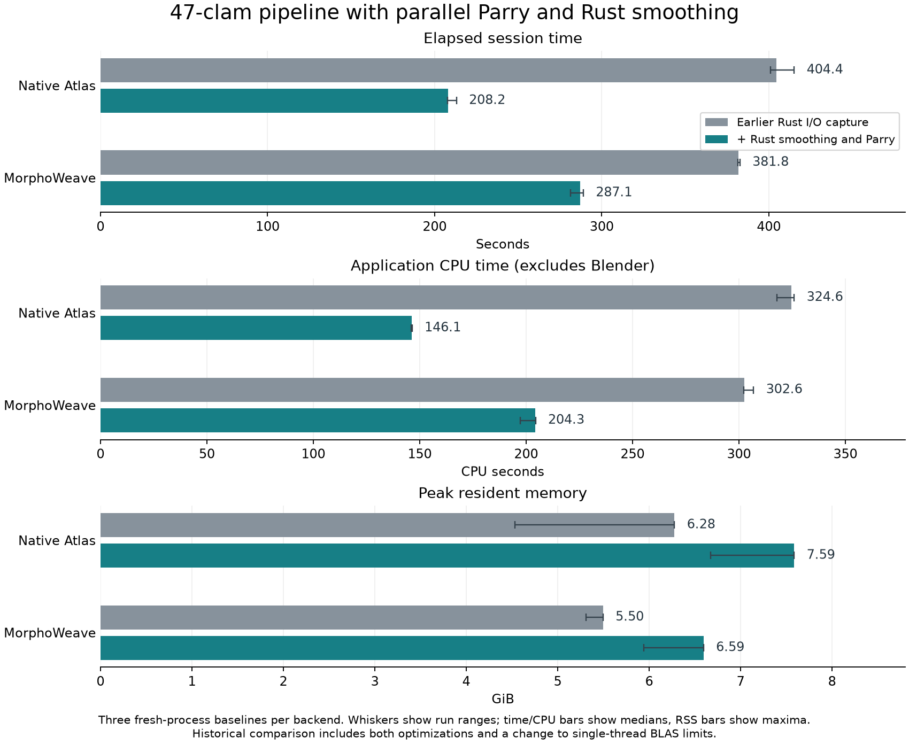
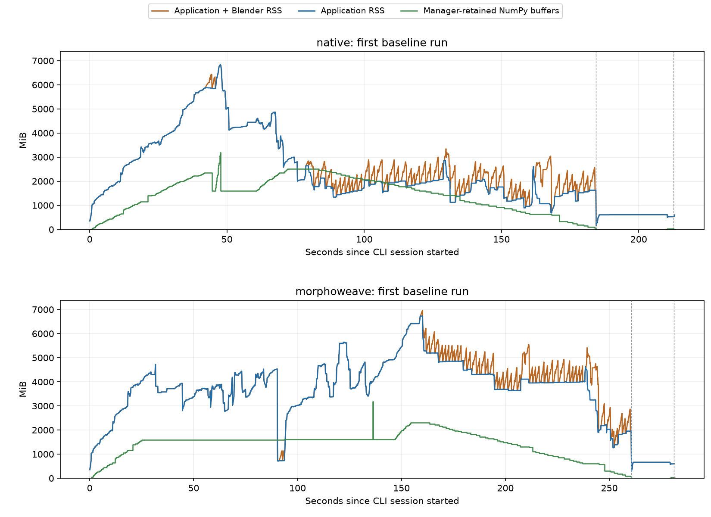

# Parallel Parry: production implementation and 47-clam profile

Production closest-surface search now uses Rust `parry3d-f64` in both atlas
backends. Implementation commit: **`f404d7c`**. All **12 captures completed**, with
**253 identical artifact hashes across six captures per backend**. Three baseline
sessions gave medians of **208.15 s for Native Atlas** and **287.15 s for MorphoWeave**.

Every generated mesh was compared with the preserved earlier population output.
MorphoWeave geometry is identical. Native's largest vertex displacement is
**4.18436e-15 input units**; triangle order and per-corner UVs are unchanged.
All baked textures and exported presentation arrays match the earlier Rust-I/O
capture exactly. Memory increased: maximum sampled application RSS was
**7.59 / 6.59 GiB**, and tracked live heap peaked at **6.54 / 6.33 GiB**.

“Native Atlas” identifies the atlas backend; both backends use the Rust extension.
The original `3d_color_package` application was not run or modified.

## Implementation and worker policy

`Spatial.index(mesh)` builds an owned float64 triangle index.
`Spatial.project(index, points)` returns read-only closest points, original face
IDs, and squared distances in query order. Geometry is copied before releasing
the GIL. Shapes, bounds, finite values, and projection failures are checked.
No vertex welding, face removal, or input reordering is performed.

Native correspondence retains its warps and barycentric reconstruction.
MorphoWeave's private host replaces surface projection and coordinate-distance
checks while retaining upstream TPS and float32 input/output rounding. Its
nearest-vertex mean algorithm remains upstream. The vendored source is unchanged
and hash-verified; these local adapters do not change standalone MorphoWeave.
The former production scalar VTK surface loop is removed. VTK remains in the
offline accuracy tool as an independent comparison engine.

- Default limit: **min(8, available CPUs)**.
- For N queries: **min(limit, max(1, N // 8192))** active chunks; zero for an
  empty batch. Fewer than 16,384 queries run serially.
- One lazy process-wide Rayon pool is shared across indices. Index construction
  is serial; point queries run independently, with no parallel reductions.
- `INTERDECA_SPATIAL_THREADS` changes the limit, still capped by available CPUs.
  It must be a positive integer and is read once per process.
- `Spatial.workers_for(N)` exposes the policy. Blender, BLAS, and upstream SciPy
  nearest-vertex searches have separate thread settings.

Eight workers won the prototype comparison. The 8,192-query grain is a conservative
scheduling policy, not a measured universal crossover or proof of optimality on
every CPU. See [the full contract](../../../rust/README.md#surface-projection).

## Baseline performance

Times are medians of three fresh-process CLI sessions. Session timing starts
after Python imports and includes Blender execution. Fingerprinting, compression,
and numerical audits happen afterward. RSS values are the largest sampled
application peaks across the three baselines, measured every 0.1 seconds.

| Metric | Earlier Native | Current Native | Earlier MorphoWeave | Current MorphoWeave |
|---|---:|---:|---:|---:|
| Session wall time, s | 404.37 | **208.15** | 381.78 | **287.15** |
| Application CPU, s | 324.64 | **146.15** | 302.61 | **204.25** |
| Blender child CPU, s | 81.41 | 81.06 | 79.53 | 79.52 |
| Maximum application RSS, GiB | 6.28 | **7.59** | 5.50 | **6.59** |
| Tracked live heap peak, GiB | 6.42 | **6.54** | 6.18 | **6.33** |

Current wall-time ranges were **207.74–213.09 s** and **281.43–289.00 s**.
Maximum process-tree RSS, including Blender, was **7.59 / 6.84 GiB**.

The elapsed-time reductions from the [earlier Rust-I/O capture](../rust-2026-10-04/RESULTS.md)
are **48.5% / 24.8%**. This historical comparison includes **both Rust smoothing
and Parry**, and the new run sets BLAS/OpenMP thread limits to one whereas the
earlier capture left them unset. Inputs and recorded dependency versions match.
These are descriptive historical comparisons, not an isolated Parry effect,
interleaved old/new trials, or confidence intervals. OS file caches were not flushed.



Median sums of baseline task durations explain the change:

| Task family | Native: earlier → current, s | MorphoWeave: earlier → current, s |
|---|---:|---:|
| Atlas contributions | 74.69 → **15.78** | — |
| Final correspondence | 41.73 → **11.51** | 29.16 → **8.35** |
| Color sampling and smoothing | 98.85 → **2.04** | 77.30 → **1.60** |
| Blender baking | 105.45 → 105.10 | 103.72 → 103.96 |
| Analysis preparation | 26.10 → 25.26 | 18.93 → 18.33 |
| MorphoWeave atlas construction | — | 49.46 → 52.84 |
| MorphoWeave aligned-specimen recovery | — | 41.82 → 45.04 |

Task medians need not sum to a session median. Building Parry indices is more
expensive than the old VTK build in the isolated experiment; MorphoWeave also
builds indices for small coordinate-check batches. Faster large-batch queries
therefore do not imply every upstream stage becomes faster.

## Spatial and CPU attribution

The separate span captures include copies, validation, index construction, and
returned NumPy arrays. Process CPU includes Rust worker threads.

| Spatial operation | Native calls | Native wall s | Native process CPU s | MorphoWeave calls | MorphoWeave wall s | MorphoWeave process CPU s |
|---|---:|---:|---:|---:|---:|---:|
| Index construction | 94 | 8.99 | 8.98 | 141 | 13.47 | 13.47 |
| Batched projection | 94 | 5.82 | 34.22 | 141 | 1.69 | 9.25 |
| Combined | — | **14.81** | **43.20** | — | **15.16** | **22.72** |

The [controlled prototype](../../../experimental_perf_tests/parry_spatial/results/RESULTS.md)
measured build-plus-query speedups of **6.23× Native-workload / 5.07×
MorphoWeave-workload** over the old Native VTK loop, using 47 meshes, three
repeats, and eight workers. Its MorphoWeave workload uses the same comparison
loop and output types; it is not a timing of the complete upstream workflow.

Both production CPU captures contain **zero** calls to the old scalar VTK
`FindClosestPoint` / `EvaluateFunction` paths. Yappi uses Python-thread CPU and
does not attribute Rust pool-worker CPU to individual functions; its tables must
not be substituted for the process totals above.

Remaining costs include image decoding (~31 self CPU seconds in each CPU
capture), analysis preparation, and OBJ I/O. MorphoWeave still makes **228 reads
and 236 writes**, with ~45.75 / 43.25 self CPU seconds in that capture. Its
upstream `_mesh_density_score` takes ~26.99 self / 50.57 inclusive CPU seconds.
These instrumented CPU values identify work; baseline timings quantify runtime.
Blender baking remains about 104–105 baseline seconds per population.

## Memory

Maximum sampled application RSS increased about **21% / 20%** relative to the
historical Rust-I/O captures. Live heap increased much less: approximately
**0.12 / 0.15 GiB**. RSS includes allocator retention and resident/shared pages;
it is not a count of currently live arrays. The two quantities have separate
captures and different peaks.

Allocation origins at each backend's live-heap peak:

| Origin | Native GiB | MorphoWeave GiB |
|---|---:|---:|
| Source specimen inspection | 2.30 | 2.30 |
| Alignment / aligned-specimen recovery | 1.55 | 2.25 |
| Resampling, excluding spatial index/query allocation | 1.61 | 0.70 |
| Spatial index/query allocation | **1.03** | **1.03** |
| Other | 0.06 | 0.05 |

The largest spatial buffers originate in Parry's `TriMesh::rebuild_bvh`.
This is a temporary index-construction cost observed while other population
meshes remain live, not 1.03 GiB retained for every specimen. Source parser
buffers and copied alignment/resampling arrays still dominate the total.
Memory optimization should consider peak index-build workspace and population
mesh lifetimes, alongside the previously identified parser spare capacity.



Memray excludes Blender after exec and starts after module imports. Native
function names resolved, but missing interpreter/debug line information limits
some stack attribution. Selected native stacks are preserved in
`profile-evidence.json`; raw allocation captures and flame graphs remain locally.

## Accuracy and correspondence

The direct audit compared **95 meshes per backend**: one atlas, 47 aligned
specimens, and 47 resampled specimens, without fitting or reordering.

- All **190 meshes** preserve triangle arrays and per-corner UVs exactly.
- MorphoWeave's **95 vertex arrays are identical** to the preserved reference.
- Native's atlas and 47 aligned meshes are identical. Its 47 resampled meshes
  differ by at most **4.18436e-15** input units, or **5.55439e-14** of the
  reference bounding-box diagonal.
- Against the earlier Rust-I/O capture, MorphoWeave matches **253/253** artifact
  hashes; Native matches **206/253**, with only its 47 resampled OBJ files changed.
  Baked textures and exported presentation arrays are byte-identical for both.

An independent VTK diagnostic then evaluated all 47 specimens with **10,000
samples per surface**, seed **413**. The following are medians of specimen
metrics; coordinate distances use the input mesh units.

| Current fidelity metric | Native | MorphoWeave |
|---|---:|---:|
| Resampled vertex → original surface RMS | 5.37e-19 | 1.67e-10 |
| Resampled triangle interior → original surface RMS | 8.63306e-5 | 9.26182e-5 |
| Original surface → resampled surface RMS | 4.35957e-4 | 4.46349e-4 |
| Transferred-landmark RMS / centroid size | 0.246864% | 0.103687% |
| Baked/source mean absolute sRGB channel error, 0–255 | 17.7104 | 19.3633 |
| Jointly opaque texture samples, pooled | 97.6868% | 98.7572% |

MorphoWeave's per-specimen diagnostics are identical to the earlier reference.
Native's largest specimen RMS change is **2.17e-19** for reverse surface coverage
and **3.58e-18** for normalized landmark error. Its largest specimen change in
mean texture diagnostic error is **0.000354 on the 0–255 scale**, although the
baked images themselves are identical. This diagnostic also depends on sampled
nearest-surface locations and face choices, which can shift under rounding.

Native's near-collapse classification changes from **35,629 to 35,557** triangles.
There are **1,066 individual classification flips** in both directions; every
affected triangle has twice-area / bounding-box-diagonal² at most **2.86e-19**.
These threshold-sensitive counts are recorded rather than treated as an
improvement. No faces are removed. MorphoWeave's count remains **24,261**.
The cross-backend PCA score-distance correlation remains **0.9884124**.

Shared edges and vertices permit tied closest-triangle IDs, so exact VTK/Parry
face-ID equality is not promised. The checks establish preservation of this
dataset's results. Surface samples are not exact Hausdorff bounds, and these
in-sample landmark/texture diagnostics are not independent anatomical ground truth.

## Validation, evidence, and reproduction

- **256 existing non-Slicer tests passed** after integration; five focused
  accuracy tests passed after the archive-reader changes.
- Production serial, parallel, and concurrent calls returned identical results
  for a 70,000-query check. Additional checks covered owned snapshots, array
  layouts, empty batches, degenerate triangles, overflow, and worker selection.
- Final verification matched the committed Python/Rust sources, compiled native
  binary, lockfile, all **142 prepared input hashes**, and all 12 run fingerprints.
- The prepared dataset has 47 specimens, 48 landmarks each, and the previously
  documented removal of one zero-area face from `UF_IZ_63733`. Raw inputs and
  the original reference implementation remain unchanged.
- Host: macOS 26.6.2 ARM64, 24 GiB RAM, 14 CPUs; Python 3.13.12, Blender 5.2.1
  LTS, NumPy 2.5.3, SciPy 1.18.1, VTK 9.7.1. Parry uses its default eight-worker
  cap; BLAS/OpenMP environment limits are one. Full metadata is in `environment.json`.
- Workload: atlas, alignment, correspondence, 512² baking, 1,000-face color
  sampling/smoothing, PCA, reconstruction, display data, selection, and export.
  Slicer startup/rendering and UMAP are excluded.

The initial sandbox attempt stopped before measuring because macOS process
queries were unavailable. The completed Native first baseline was then preserved
while disk space was recovered from regenerable build/dependency caches. All
remaining captures resumed with the same code and inputs. Baseline meshes are
losslessly compressed only after timing and hash verification; images and arrays
remain available. Later captures retain profiler evidence and verified hashes.
Whole-host memory/disk monitoring starts during the second MorphoWeave baseline;
it is partial context, not application memory attribution. During that monitored
interval, available host memory stayed above 4.58 GiB, existing swap usage went
from 10.75 to 10.49 GiB, and free disk briefly reached 0.85 GiB during staging.
These resource constraints are recorded in `host-context.json` and limit how
broadly the timings should be generalized to other hosts.

Committed evidence includes `baseline-overview.json`, `summary.json`,
`profile-evidence.json`, `geometry-delta.json`, `accuracy.json`,
`accuracy-comparison.json`, and `verification.json`. Raw profiles, logs,
first-baseline output archives, the HTML report, and an archive of the exact
measured sources/native binary remain in `build/profiling/parry-47-2026-10-04/`.

To repeat the performance captures after `just rust-build`:

```sh
OPENBLAS_NUM_THREADS=1 OMP_NUM_THREADS=1 MKL_NUM_THREADS=1 \
VECLIB_MAXIMUM_THREADS=1 .venv/bin/python -m tools.profiling \
  --inputs '/path/to/prepared/inputs' --expected-specimens 47 \
  --repeats 3 --archive-first-baseline \
  --output build/profiling/parry-repeat/current
.venv/bin/python -m tools.profiling.summarize build/profiling/parry-repeat/current
```

Place the matching `dataset.json` and an `inputs` link at the `parry-repeat/`
root, then run `python -m tools.profiling.accuracy build/profiling/parry-repeat`.
`geometry_audit.py --reference <preserved-current> --candidate <new-current>
--output <json>` reproduces the direct comparison when run with `PYTHONPATH=.`.
`plot.py` regenerates the performance chart from the adjacent baseline values.
