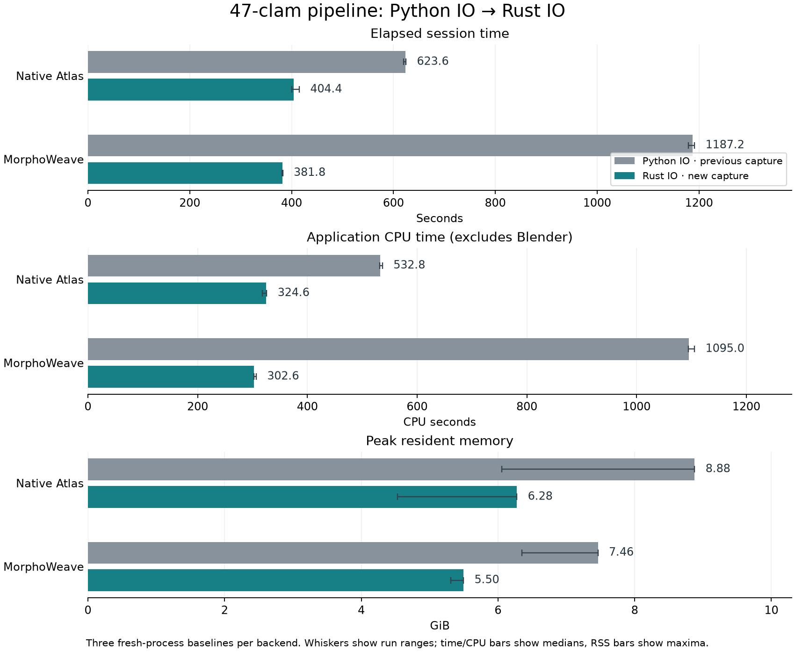
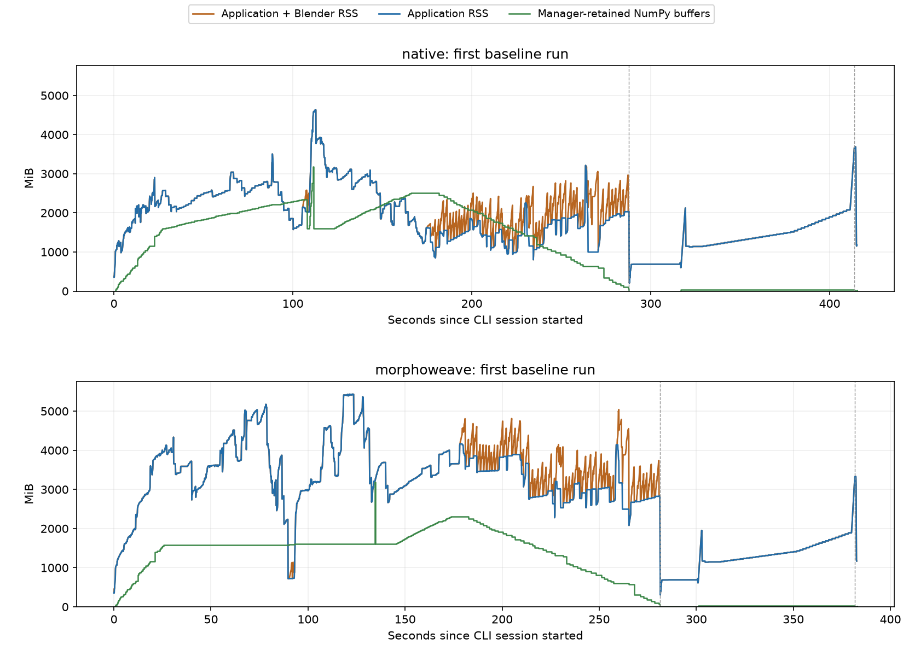

# Production Rust I/O: full 47-clam pipeline

Measured on 2026-10-04. Both atlas backends now use the production Rust OBJ reader,
validator and writer, plus fused texture conversion. Native Atlas completed in a
median **404.37 s** and MorphoWeave in **381.78 s**. Compared with the previous
Python-I/O captures on the same dataset and host, these are **35.2%** and **67.8%**
reductions in elapsed time. MorphoWeave still reads OBJ files 228 times; the
replacement makes each read cheaper rather than changing the workflow.

“Native Atlas” means InterDeCA's original atlas backend. Both backends use the Rust
extension in this experiment. This does not run the separate `3d_color_package`
application.

## Whole-pipeline results

Each baseline is a fresh CLI process. Times below are medians of three baseline
runs; memory is the largest sampled application RSS peak across those runs.

| Metric | Native Atlas, Python I/O | Native Atlas, Rust I/O | MorphoWeave, Python I/O | MorphoWeave, Rust I/O |
|---|---:|---:|---:|---:|
| Session wall time, s | 623.61 | **404.37** | 1187.19 | **381.78** |
| Application CPU time, s | 532.76 | **324.64** | 1094.98 | **302.61** |
| Blender child CPU time, s | 81.98 | 81.41 | 81.19 | 79.53 |
| Maximum sampled application RSS, GiB | 8.88 | **6.28** | 7.46 | **5.50** |

Rust wall-time ranges were 400.87–415.19 s for Native Atlas and 381.37–382.71 s for
MorphoWeave. RSS peaks varied more: 4.53–6.28 GiB and 5.31–5.50 GiB respectively.
The process-tree RSS peaks equaled the application peaks in these baselines.
RSS measures resident pages, including allocator retention; it is not the same
quantity as live heap allocations or NumPy array sizes.



The historical Python captures are from revision `3aa93df76d4736d5d877f3fa4783de71610391d4`
under the prepared dataset's `current/` directory. Inputs, dependency versions and
thread settings match. These are descriptive comparisons with historical runs,
not interleaved old/new trials or confidence intervals. OS file caches were not
flushed. Baselines include task/resource instrumentation, including a recursive
walk that counts retained arrays.

## What takes time now

These task-family wall times are medians of the three Rust baseline runs, summed
within each family. They identify useful targets without Yappi's substantial
per-call overhead. They do not include all session bookkeeping.

| Task family | Native Atlas, s | MorphoWeave, s |
|---|---:|---:|
| Bake textures through Blender | **105.45** | **103.72** |
| Sample and smooth specimen colors | **98.85** | **77.30** |
| Native atlas contributions | **74.69** | — |
| MorphoWeave atlas construction | — | **49.46** |
| Recover MorphoWeave aligned specimens | — | **41.82** |
| Resample correspondence | **41.73** | **29.16** |
| Prepare analysis geometry | 26.10 | 18.93 |
| Inspect 47 source specimens | 25.91 | 26.08 |

The separate CPU profiles explain these costs:

- Color smoothing makes **10,569,717** calls to `numpy.average` for Native Atlas
  and **8,190,803** for MorphoWeave. The averages and their weight/axis checks
  dominate the color stage. `sample_specimen_colors` has 760.53/586.57 inclusive
  CPU seconds under Yappi; these inflated numbers are for attribution, not a
  prediction of normal runtime. It smooths all 231,597/177,665 atlas faces before
  selecting 1,000 faces.
- VTK `FindClosestPoint` executes **15,132,167 / 4,092,854** times, consuming
  **107.21 / 28.14** self CPU seconds in the instrumented captures. Native Atlas
  performs more correspondence work. VTK is already compiled; reducing or
  batching queries is the relevant opportunity.
- Pillow image decoding consumes **31.17 / 30.96** self CPU seconds. The fused
  Rust texture arithmetic totals only about **0.29 / 0.31** CPU seconds in the
  separate span captures. Baking and decoding dominate texture work here.
- MorphoWeave's `_mesh_density_score` has 26.95 self CPU seconds in 28 calls.

The CPU profiler also spends substantial time walking retained objects in
`tools/profiling/capture.py`. Generic `id`, `isinstance`, set operations and lock
waits include instrumentation work; they are not ranked as application targets.
Inclusive times nest and must not be added together. Neither Yappi nor Memray
captures should be used as baseline elapsed-time measurements.

### OBJ cost and repeated loading

| Rust endpoint | Native Atlas calls | Native Atlas CPU s | MorphoWeave calls | MorphoWeave CPU s |
|---|---:|---:|---:|---:|
| Read and validate OBJ | 47 | 9.14 | 228 | 45.52 |
| Validate and write OBJ | 95 | 14.23 | 236 | 40.23 |
| Combined | 142 | **23.37** | 464 | **85.75** |

These are exclusive thread CPU times from the span captures. Together the Rust
endpoints account for about **6.9% / 27.8%** of the same captures' application CPU.
The previous Python read/write spans totaled 238.05/875.11 s. Their scope is not
perfectly identical: separately instrumented Python validation was subtracted
from the old exclusive spans, while native validation is inside the new endpoints.

MorphoWeave still communicates through staged and aligned files. It performs the
47 initial inspections plus 181 underlying reads through its cache. The cache
recorded 8 hits, 181 misses, 88 read bypasses and 219 evictions; its budget is
192 MiB and its peak accounted array size was 191.44 MiB. Large meshes and the
file-oriented upstream workflow explain why this change alone does not eliminate
reloading. The cache's array budget does not include all source/aligned specimens
held by the application, nor spare Rust buffer capacity.

## What holds memory

The Memray captures measure simultaneously live allocations in the application
process after imports. They include Rust and NumPy allocations, but do not follow
Blender after exec. Their peak was **6.42 GiB for Native Atlas** and **6.18 GiB for
MorphoWeave**. Previous tracked heap peaks were 6.13 and 6.70 GiB: Native Atlas's
heap peak increased slightly even though sampled RSS decreased. There is no
across-the-board heap reduction to claim.

Allocation origins at each backend's own heap peak:

| Origin in the allocation stack | Native Atlas, GiB | MorphoWeave, GiB |
|---|---:|---:|
| Source specimen inspection | 2.30 | 2.30 |
| Native alignment / MorphoWeave aligned-specimen recovery | 1.55 | 2.25 |
| Resampling | 1.62 | 0.68 |
| Other live allocations | 0.96 | 0.95 |

These rows group allocation stacks by their nearest listed application operation;
they describe where memory was allocated, not which task was running at the peak.
The largest individual sites are:

- The 47 source meshes retain **2,352 MiB** of Rust vector storage: 1,344 MiB,
  672 MiB and 336 MiB across the parser's three buffers. Their logical NumPy data
  is about **1.545 GiB**. Growable vectors retain spare capacity when transferred
  into NumPy ownership, accounting for roughly **0.75 GiB** of extra capacity for
  this source set. This is a concrete next memory optimization.
- Native alignment retains **904 MiB of copied per-corner UVs**, **452 MiB of
  faces** and **226 MiB of vertices** through `Mesh.validated`/`Arrays.frozen`.
  Resampling holds another set of geometry arrays.
- MorphoWeave aligned-mesh reads retain another **2,212 MiB** of Rust buffer
  storage across 43 read meshes at the heap peak, alongside the source meshes.
- General Python mesh validation still allocates a **207 MiB** triangle gather
  for the largest specimen (`vertices[faces]`). Rust replaces validation at the
  I/O boundary; algorithms still use the general `Mesh.validated` contract.

The manager's logical retained-array count reaches about **3.11 GiB** in each
backend. This excludes vector spare capacity, native VTK allocations, metadata,
temporary arrays and allocator slack. It therefore cannot explain RSS by itself.
Baseline RSS maxima happened around `saved_atlas` / `resampled_0`; this does not
mean those short tasks allocated all the resident pages.



Memray resolved Rust allocation symbols but reported missing Python interpreter
debug symbols. Python stacks and tracked byte totals remain available; some
native frames have unknown file/line information. Full hybrid stacks are retained
in the raw report and selected stacks in `profile-evidence.json`.

## Recommended next work

1. Release source/aligned/resampled meshes when their consumers finish, and avoid
   copying unchanged topology and per-corner UVs through general validation.
2. Trim or size Rust parser buffers before handing them to NumPy. Measure the
   reallocation cost against the observed spare-capacity saving; this experiment
   did not change the parser's growth strategy.
3. For the single smoothing pass used here, compute averages only for selected
   faces while retaining raw colors from all needed neighbors. Simply dropping
   unselected neighbors would change the result. Multiple smoothing passes need
   a larger dependency neighborhood or a batched full-face implementation.
4. Reduce MorphoWeave's file round trips, then examine VTK query batching and
   Blender baking. Rewriting more small Python I/O helpers would have less effect.

## Workload, correctness and provenance

- Full 47 prepared clam specimens, 48 landmarks each; 9,877,061 vertices and
  19,753,936 triangles in the source set. Input images comprise 27 at 4096²,
  18 at 8192² and 2 at 2048² pixels.
- The shared prepared dataset removes one exactly zero-area triangle from
  `UF_IZ_63733`; raw originals remain unchanged. Both old and new validators
  reject that face. Input hashes are recorded in `environment.json`.
- End-to-end CLI actions cover atlas construction, alignment, correspondence,
  512² texture baking, 1,000-face color sampling with neighbor averaging, PCA,
  reconstruction, display-data generation, selection, export and clear selection.
  Slicer startup/rendering and UMAP are excluded. Different atlas backends produce
  different atlas geometries, so their downstream workloads are not identical.
- Three baselines plus one span, CPU and allocation capture per backend: **12
  successful captures**. All **253 artifact hashes match across six runs within
  each backend**. Against historical outputs, **158 non-OBJ artifacts match
  exactly** per backend, including presentation arrays. The other 95 artifacts
  are OBJ text files whose float formatting changed.
- Separately, all 47 source meshes match the old Python reader exactly in array
  shape, dtype and bytes. RAS/LPS conversion and Rust write/read round trips were
  also checked for every mesh. This does not claim every generated OBJ text file
  was individually parsed and compared against its historical counterpart.
- Inputs here are already RAS. Fused LPS conversion is covered by correctness
  checks but contributes no coordinate-conversion speedup to these captures.
- Host: macOS 26.6.2 ARM64, 24 GiB RAM, 14 CPUs, Python 3.13.12, Blender 5.2.1 LTS,
  NumPy 2.5.3, SciPy 1.18.1, VTK 9.7.1, Yappi 1.7.6, Memray 1.20.0. Thread-limit
  environment variables were unset. Exact metadata is in `environment.json`.
- Measured production implementation: commit
  `ac90672fe0d65c863ac471b21119bc6d37dbe1dc`. The first capture exposed an off-timer
  artifact-fingerprint path bug. The helper was corrected and all hashes verified
  without rerunning or changing the measured application; `capture-repair.json`
  records this correction.
- After all captures and native allocation reports finished, array-layout guards
  were added for unaligned, empty and excessive-rank inputs. Normal numerical
  loops and parser behavior are unchanged. The profile describes the archived
  measured binary, not a fresh whole-pipeline run of that final guard revision.
  Correctness checks and the test suite were rerun after the guard change:
  **243 tests passed**, and all **47 mesh comparisons/round trips passed**.

Raw profiles, logs, complete output hashes, HTML reports and an archive of the
exact measured sources/native binary remain in
`build/profiling/rust-47-2026-10-04/`. Large generated OBJ/PNG/NumPy outputs were
hashed and removed after each run, outside the timed session. The committed
evidence here contains the baseline samples, selected CPU/allocation records,
environment, measured-source hashes, verification results and figures. Raw
profiles and experimental prototype code are not committed.

## Local build and reproduction

Install Rust's toolchain plus `uv` and `just` for development. `just rust-setup`
installs the environment and optimized extension. After editing Rust, use
`just rust-build`; Python remains editable. `just rust-dev` is an unoptimized
debug build and should not be used for performance comparisons. `just rust-wheel`
builds the platform wheel. End users receiving a matching prebuilt wheel need no
Rust compiler; publishing wheels for supported platforms remains release work.

The native implementation lives under `rust/` and is built by Maturin as
`interdeca._native`. Python `MeshIO` keeps format dispatch and VTK integration;
the obsolete Python OBJ parser/writer and texture arithmetic are removed.

To repeat the captures with the prepared dataset:

```sh
just rust-build
.venv/bin/python -m tools.profiling \
  --inputs '/Users/eric/Library/Application Support/InterDeCA/full-population-2026-10-03/inputs' \
  --expected-specimens 47 --output build/profiling/rust-47-repeat \
  --repeats 3 --timeout 14400 --omit-artifacts
.venv/bin/python -m tools.profiling.summarize build/profiling/rust-47-repeat
```

Run outside a sandbox that blocks macOS process-resource queries. To regenerate
the comparison chart from committed samples, run
`python docs/profiling/rust-2026-10-04/plot.py` with Matplotlib installed.
